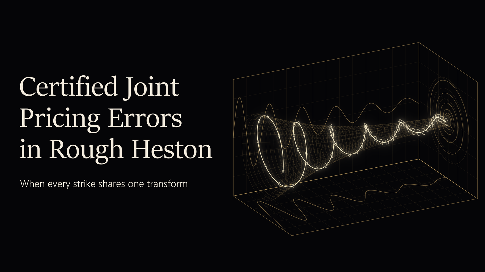
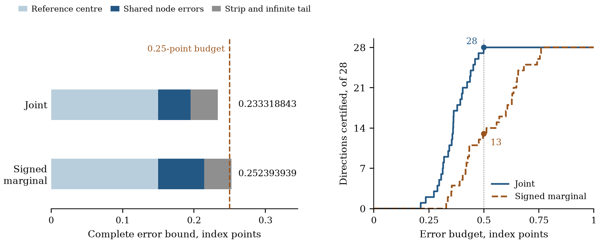

# Certified Joint Pricing Errors in Rough Heston

**When every strike is priced from one approximate transform, how much numerical error is left in the portfolio?**

[Read the paper](ARTICLE.md) · [PDF](paper/paper.pdf) · [Evidence](docs/EVIDENCE.md) · [Verification](COMMANDS.md)

Options with the same maturity and model parameters share one characteristic function, so an error in the transform reaches every strike at once. This paper answers with deterministic error certificates. Starting from the exact fractional Riccati equation, it derives a residual error identity and a finite-history pricing kernel fixed by the forward variance curve and the positive fractional resolvent, and it keeps the shared transform errors together in a joint outer set of price errors.

Research by **Theodore Ouyang**

## Three results to start with

| Result | Why it matters | Evidence |
|---|---|---|
| **0.233 against 0.252 index points** | For the quarter-year 4400–4500 call spread, joint aggregation certifies the 0.25-point budget, and signed marginal aggregation of the same node radii does not. The complete error upper bound is 7.56% lower. | Theorem 5.1 and Table 10; [exact ledger](science/analysis/audit/quarter-exact-ledger.json) |
| **28 of 28 directions against 13** | At a half-point budget the joint certificate passes every one of the 28 fixed six-month portfolio directions. Marginal aggregation passes 13. | Table 11; [pass counts](science/analysis/audit/portfolio-budget-counts.json) |
| **72.91% from finite-history propagation** | The finite-history kernel lowers the six-month complete bound from 1.397612096 to 0.378598956 index points, with the stored output and its centre unchanged. | Theorem 3.1 and Table 3; [staged comparison](ARTICLE.md#71-fixed-contracts-units-and-complete-ablation) |

The quarter-year comparison uses the same stored output, reference centre, **1,025 node radii** and remaining error terms in both accounts. The direction counts are for the six-month contract at α = 0.52 with finite-history propagation.

## The result behind the headline

On the left, both bars carry the same reference centre and the same strip and tail remainders. Combining the portfolio coefficients before absolute values are taken lowers the node-error term from 0.064536889507 to 0.045461793432, and the complete bound moves from **0.252393939** to **0.233318843** index points, across the **0.25-point** budget. On the right, each curve counts how many of the 28 fixed six-month directions are certified as the budget grows. At half a point the joint certificate has all **28**, and marginal aggregation has **13**.

## The mathematical idea

The transform solves a nonlinear fractional Riccati equation, and its accumulated history stays part of the equation at every later time. For an absolutely continuous reference trajectory, subtraction still gives an exact linear error equation with a state-dependent coefficient, whose real part is controlled by the left half-plane geometry of the Riccati flow. Integration by parts moves the fractional derivative from the state error to the forward variance curve, and the positive fractional resolvent turns that identity into a history weight for the residual. The resulting propagation bound keeps the complete history, the curve's initial value and the physical scaling.

Once a complex disk encloses each transform error, the pricing functional fixes a convex set of possible price errors. The paper derives the **exact support function** of this joint outer set. Because the portfolio coefficients are combined before absolute values are taken, cancellation across strikes is captured, and the equality case of the complex triangle inequality says exactly when separate price bounds lose nothing.

The complete certificate also covers the displacement between the reference and the stored output, the finite omitted frequencies, quadrature, the infinite tail and arithmetic. It certifies numerical error relative to the specified model, which is a separate question from market mispricing.

## What the repository holds

The scientific package contains the propagation proofs, a structural certificate for the specified rational output, all **27 numerical banks**, and readers for the reported price and portfolio bounds.

- [Evidence map](docs/EVIDENCE.md): each result with its proof, its data and its calculation.
- [Verification](COMMANDS.md): the executable checks behind the reported certificates.
- [Verification records](validation/README.md): the records of file identity, scientific reconstruction and presentation.

## Paper

**Certified Joint Pricing Errors in Rough Heston** — Theodore Ouyang.

[Article](ARTICLE.md) · [PDF](paper/paper.pdf)

[theodore.oy2025@gmail.com](mailto:theodore.oy2025@gmail.com) · [10@alumni.duke.edu](mailto:10@alumni.duke.edu)

© Theodore Ouyang. All rights reserved.
