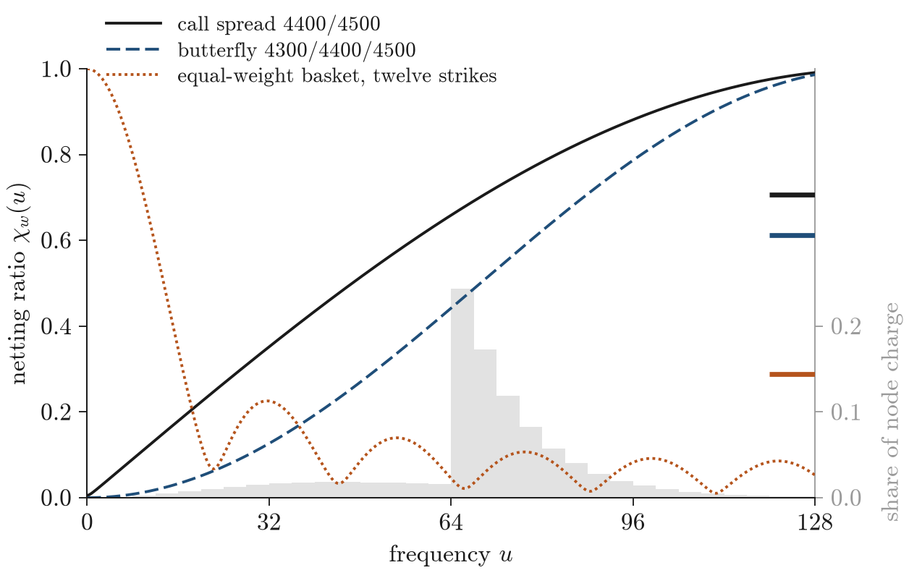

# Certified Joint Pricing Errors in Rough Heston

**When every strike is priced from one approximate transform, how much numerical error is left in the portfolio?**

[Read the paper](ARTICLE.md) · [PDF](paper/paper.pdf) · [Evidence](docs/EVIDENCE.md) · [Verification](COMMANDS.md)

Options with one expiry are priced from a single characteristic function, so a numerical error in that function is a common factor across strikes. A position hedged in strike space is hedged against it, and a position spread over many strikes diversifies it. The paper turns this into a deterministic certificate for the rough Heston model: a bound on the distance between a stored vector of prices and the exact model prices, in any portfolio direction. A residual in the fractional Riccati equation is priced by a forward variance curve, with constant one, and the exposure of a portfolio to the transform error is the Fourier transform of its payoff.

Research by **Theodore Ouyang**

## Three results to start with

| Result | Why it matters | Evidence |
|---|---|---|
| **0.233 against 0.252 index points** | For the three-month 4400–4500 S&P 500 call spread, netting the legs certifies a quarter-point tolerance and bounding them one by one does not. The stored prices, the reference, all 1,025 node radii and every remainder are identical. | Theorem 5.1 and Table 4; [exact ledger](science/analysis/audit/quarter-exact-ledger.json) |
| **A Riccati residual costs forward variance** | The log-characteristic function moves by at most the residual integrated against the forward variance curve of the model under the measure midway between the risk-neutral and share measures. The constant is one and the leverage effect supplies the damping. On the six-month spread the complete bound falls from 1.398 to 0.379 points, by 72.91%. | Theorem 3.1, Proposition 3.2 and Table 2 |
| **0.708 for spreads, 0.076 for a basket** | Transform error behaves like a factor model in frequency. Adjacent call spreads keep 0.708 of their leg-by-leg node error, against a Herfindahl level of 1/√2; an equal-weight basket of twelve calls keeps 0.076; a five-point vertical keeps one twenty-fourth. | Propositions 5.2 and 5.3, Tables 6 and 7; [market-scale record](science/analysis/market/market-scale.json) |

The quotes are S&P 500 index options of 18 June 2021. One index point is 100 dollars a contract, and a quarter point is about a fifth of the quoted width of the six-month 4400 call.

## The result behind the headline

On the left, both bars carry the same reference centre and the same strip and tail remainders. Combining the portfolio coefficients before absolute values are taken lowers the node-error term from 0.064536890 to 0.045461793, and the complete bound moves from **0.252393939** to **0.233318843** index points, across the **quarter-point** tolerance. On the right, each curve counts how many of 28 fixed six-month spreads, butterflies and baskets are certified as the tolerance grows. At half a point the joint certificate has all **28**, and the leg-by-leg certificate has **13**.

## The mathematical idea

The transform solves a nonlinear fractional Riccati equation that carries its whole history. An approximate solution fails the equation by a residual, and the would-be pricing martingale then drifts in proportion to variance. Theorem 3.1 makes this exact for the exponent: the residual is weighted by a forward variance curve, the expected variance of the same model after the leverage effect has sped up mean reversion by half its share-measure amount. There is no Grönwall constant, and the one hypothesis on the curve is the condition under which the model is known to exist.

A portfolio of options with one expiry is a single payoff, and the paper prices its error as one payoff. The **netting ratio** compares the modulus of the payoff transform with the sum over the legs. For a vertical spread it is close to |sin(uΔ/2)|: the spread is hedged against transform error whose wavelength is long compared with its strike spacing and fully exposed at the Nyquist frequency. For a butterfly the ratio is squared, and for any position its mean square is the Herfindahl index. Low-frequency error is systematic across strikes and is removed by hedging; high-frequency error is idiosyncratic and is removed by diversification.

## What the certificate decides

- **Tolerances inside the bid–ask spread.** The stored rational-approximation price of the six-month 4400–4500 spread is certified to 0.115 points, against a quoted width of about 2.5.
- **Roughness rankings.** Five candidates from H = 0.02 to H = 0.05 are ordered by their distance to the quotes with all ten pairs separated, against seven of ten without netting.
- **Model misfit.** At the best candidate the exact model price of the 4400 call lies at least 0.49 points above the quoted ask, a discrepancy the certificate attributes to the model.

The certificate bounds numerical error relative to the specified model; whether the model fits the market is a separate question, and the third result is an instance of it.

## What the repository holds

The scientific package contains the propagation proofs, the structural certificate of the rational output, all **27 numerical banks**, and readers for the reported price and portfolio bounds.

- [Evidence map](docs/EVIDENCE.md): each result with its proof, its data and its calculation.
- [Verification](COMMANDS.md): the executable checks behind the reported certificates.
- [Verification records](validation/README.md): the records of file identity, scientific reconstruction and presentation.

## Paper

**Certified Joint Pricing Errors in Rough Heston** — Theodore Ouyang.

[Article](ARTICLE.md) · [PDF](paper/paper.pdf) · [LaTeX](paper/paper.tex)

[theodore.oy2025@gmail.com](mailto:theodore.oy2025@gmail.com) · [10@alumni.duke.edu](mailto:10@alumni.duke.edu)

© Theodore Ouyang. All rights reserved.
