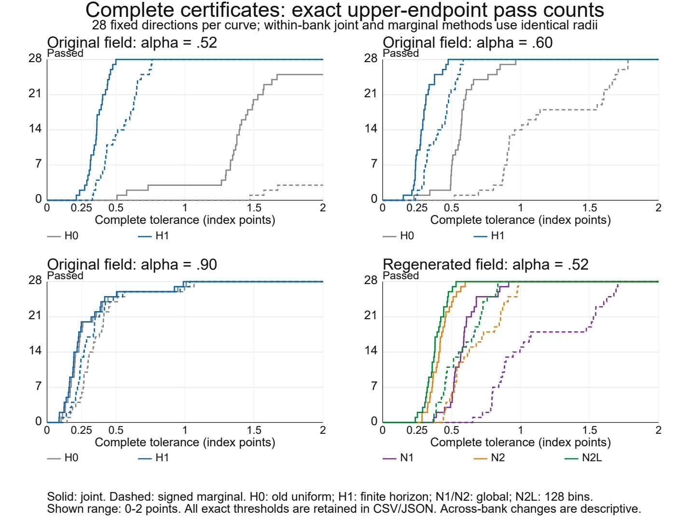

# Rough Heston 模型的可验证联合定价误差

## 摘要

当所有执行价都使用同一个近似变换定价时，期权组合还剩下多少数值不确定性？在 Rough Heston 模型中，逐项价格区间会丢失各 Fourier 频率处共同的复误差。本文先从分数阶 Riccati 方程推导残差界，再将组合定价泛函作用于共享变换误差，构造联合误差集合。传播核由远期方差曲线与正分数阶预解核共同确定，保留全部历史和曲线初值项。由此得到的支撑函数公式，精确刻画了逐项价格界何时不损失信息。该方法还包围已经算出的定价输出，完整计入它与认证参考中心的位移、求积、无限尾部及算术误差。在同条件的四分之一年期看涨价差比较中，完整联合上界为0.233318843个指数点，有符号边际聚合上界为0.252393939个指数点，二者分处0.25点预算的两侧。其余实验分别考察历史权重、参考精化与输出替换的作用。本文认证的是相对于指定模型的数值误差，不将其等同于市场定价偏差。

**关键词：** 粗糙 Heston；分数阶 Riccati 方程；后验误差；组合估值；共享 Fourier 误差。

## 1. 引言

组合价值常由分别计算的期权价格相加得到，数值不确定性却未必按相同方式相加。具有相同期限和模型参数的期权共享同一特征函数，因此该函数中的误差通过已知 Fourier 系数进入每个执行价。对于看涨价差，这些系数可能大幅抵消。若先将各项绝对误差界相加，就会在形成组合之前丢失这部分信息。

本文研究如下问题：给定一组已经存储的 Rough Heston 期权价格，能否证明其在指定组合方向上的误差不超过某个金额容差？这里固定待检查的输出，界定它与精确模型价值的差，而不以另一数值求解器与它的一致程度推断精度。当估值需要按交付结果接受检查，或同一次定价计算要服务于多个组合方向时，这一区别十分重要。

令 \(c^*\) 为精确归一化模型价格向量，\(c^{\rm fast}\) 为存储输出，\(\bar c\) 为有限参考和。给定实组合向量 \(w\)、远期价格 \(F_T\)、贴现因子 \(D\) 及容差 \(\tau\)，需要判定的是

\[
DF_T\left|w^\top(c^*-c^{\rm fast})\right|\le\tau.
\]

只有参考自身的不确定性受到控制，它才可用于这一判定。对输出误差加减该参考，得到精确分解

\[
c^*-c^{\rm fast}=d+\operatorname{Re}(A\delta)+r,
\qquad d=\bar c-c^{\rm fast}.
\tag{1.1}
\]

其中 \(A\) 包含已知定价系数，\(\delta_n\) 是频率 \(u_n\) 处所有执行价共用的同一个变换误差。余项 \(r\) 包含有限变换表示之外的误差。因此，两个问题有明确的先后顺序：先包围变换误差，再确定如何为组合汇总这些界。

### 1.1. 从 Riccati 方程到组合误差

变换由非线性分数阶 Riccati 方程确定。我们先明确其唯一精确解及定价泛函。由于分数阶导数保留累积历史，不能像常微分方程那样，在中间时刻直接重新启动论证。不过，对绝对连续的参考轨迹，将精确方程与参考方程相减，仍可得到系数依赖于状态的精确线性误差方程。Riccati 流的左半平面几何控制了该系数的实部。

指数误差还具有另一条有用的恒等式。分部积分把状态误差上的分数阶导数转移到远期方差曲线上。将此恒等式与正标量预解核结合，便得到残差的历史权重。该权重由方程与收益变换确定，并非为复现某个数值价格而选取。定理3.1给出相应误差界：零耗散时得到非扩张界，正耗散时得到更紧的界。

每个变换误差一旦由复圆盘包围，式(1.1)便确定一个可能价格误差的凸集合。计算该集合在方向 \(w\) 上的支撑函数，需要先组合 Fourier 系数，再取模长。定理5.1给出这一外包集合的精确支撑函数。随后，复数三角不等式的等号条件精确说明，逐项价格界何时没有损失，以及保留共同误差何时能严格缩小区间宽度。这是一个结构性条件，在任何数值例子之前建立。

由此可以为存储输出形成完整证书。中心位移 \(d\)、有限省略频率、条带求积、真实无限尾部及算术误差都留在误差界中。如果参考中心也发生变化，仅缩小变换半径未必能改善存储输出的误差界。因此，明确保留这些项是数学构造的一部分。

### 1.2. 近似的作用

误差定理适用于满足其假设的一般参考轨迹。在计算中，我们先提取 Riccati 方程所决定的最初几个启动幂次，再将分段仿射函数的分数阶积分作为参考。这一选择有两个目的：显式表示零时刻的奇异行为，并通过精确分数阶积分在连续时间上包围残差。第4节先推导启动系数，再引入其存储的数值版本。证书要求控制每个闭时间单元上的完整残差；采样节点处的小残差并不足够。

主要例子所检查的输出采用 Gatheral–Radoicic 的既有三阶有理近似。两端匹配给出紧凑的生产公式，第6节则在明确参数域上证明其结构性质。这些性质本身并不确立定价精度。独立参考提供误差包含，再由式(1.1)将它转移到生产输出。两种构造因此承担不同的数学任务。

第7节的四分之一年期价差在联合聚合与边际聚合中使用相同的存储输出、参考中心、节点半径和其余误差项，仅改变聚合方式。完整误差界分处四分之一点预算的两侧。其他例子说明改善的边界：参考生成有成本；允许替换输出时，直接返回参考也是一种选择；数值误差证书并不能证明模型与市场报价一致。有限候选实验固定整条远期方差曲线，并将报价兼容性与目标函数排序分开报告。

### 1.3. 相关研究

Gatheral–Radoicic [GR2019, GR2023] 通过匹配分数阶 Riccati 解的短时和长时行为推导有理近似。Jeng–Kilicman [JK2020, JK2021] 研究全局 Padé 近似和 SPX 定价数据。本文采用其近似框架。这里的结构结果针对明确参数域上的原始匹配系统，与残差证书分别成立。

Abi Jaber–El Euch [AbiJaberElEuch2018] 给出第2节所用的 Volterra 模型与仿射变换。误差传播所需的分析工具也已有基础：Caputo 凸性 [LiLiu2018]、正分数阶残差比较 [Kopteva2021]、Mittag–Leffler 正性 [SimonCM2015]，以及条带梯形分析 [TrefethenWeideman2014]。本文将这些结果用于模型的指数泛函，保留曲线初值项与物理尺度，再把所得共同变换误差传递到组合方向。附录C给出这一组合所需的正则性及端点论证。

Bayer–Breneis [BBWeak2023, BBSimulation2023] 研究 Markovian 核近似与模拟方法。Boyarchenko–de Innocentis–Levendorskii [BL2025] 研究可靠的 Rough Heston 定价与校准，其修正 Adams 方法是本文的一项数值对照。Ben Hammouda 等 [BenHammouda2026] 在单层和多层方法中分配时间离散与 Fourier 求积误差。Hager–Kreher [HK2026] 研究 Hurst 参数展开。本文的问题是对指定输出给出包含完整余项的后验包围，其范围不同于复杂度界、观察到的收敛率，或名义求解器之间的比较。

第2节定义精确问题。第3–4节从连续残差得到认证变换值。第5节推导组合误差集合及其金融含义。第6节说明实验采用的有理输出，第7节给出同条件比较。附录A–E包含模型依据、详细证明与复现记录。经典 Heston 扩展另存为补充材料。

## 2. 精确定价问题

本文的分数阶积分及 Caputo 导数约定为
\[
I^\alpha f(t)=\frac1{\Gamma(\alpha)}\int_0^t(t-s)^{\alpha-1}f(s)\,ds,
\qquad D_C^\alpha v=I^{1-\alpha}v',\quad v\in AC.
\tag{2.1}
\]
在下文所用场的正则性下，\(I^\alpha f\in AC\) 且初值为零，故 \(D_C^\alpha I^\alpha f=f\)。Caputo 算子及其缩放均保留分数阶定义。令 \(a=u-i/2\)，物理 Riccati 状态 \(h\) 满足
\[
D_{C,t}^\alpha h=-\frac{a^2+ia}{2}
 +(i\rho\nu a-\lambda_R)h+\frac{\nu^2}{2}h^2,\qquad h(0)=0.
\tag{2.2}
\]
定义
\[
x=\nu^{1/\alpha}t,\quad y=x^\alpha=\nu t^\alpha,\quad
H(x)=\nu h(t),\quad Z(t)=H(\nu^{1/\alpha}t),\quad
\kappa=\lambda_R/\nu,
\tag{2.3}
\]
\[
b=(u^2+1/4)/2,\quad s_0=\kappa-\rho/2,\quad d=-s_0+i\rho u,\quad
F(z)=-b+dz+z^2/2.
\]
则 \(D_{C,x}^\alpha H=F(H)\)，\(D_{C,t}^\alpha Z=\nu F(Z)\)。归一化状态误差除以 \(\nu\) 才是物理 \(h\) 误差；物理残差 \(r_t=D_t^\alpha\widehat Z-\nu F(\widehat Z)\) 除以 \(\nu\) 才是规范方程的残差预算。

概率模型与数值例子固定 \(\kappa=0\) 及整条远期方差曲线
\[
\xi_*(t)=\theta+(V_0-\theta)E_{\alpha_0}(-\lambda_\xi t^{\alpha_0}),
\quad
(\alpha_0,V_0,\theta,\lambda_\xi)=(.5286,.0262,.0721,.5037).
\tag{2.4}
\]
曲线参数 \(\lambda_\xi\) 与 Riccati 参数 \(\lambda_R\) 分别定义。候选 \(\alpha\) 变化时 (2.4) 不随之重算。概率模型为
\[
V_t=\xi_*(t)+\nu\int_0^tK_\alpha(t-s)\sqrt{V_s}\,dW_s,\quad
K_\alpha(t)=t^{\alpha-1}/\Gamma(\alpha),\qquad
dS_t=S_t\sqrt{V_t}\,dB_t,\quad d\langle B,W\rangle_t=\rho\,dt.
\tag{2.5}
\]
式(2.5)为零Riccati均值回复下的远期方差表示。附录A依据Abi Jaber–El Euch的定理2.1、2.3及例2.2，验证该曲线所对应的概率模型与仿射变换。

以 \(M_T=S_T/F_T\) 为归一化正鞅，\(\phi_T(a)=\mathbb E M_T^{ia}\)，精确特征指数为
\[
L_T(u)=\int_0^T\xi_*(T-t)F(Z(t,u))\,dt,\quad
\phi_T(u-i/2)=e^{L_T(u)}.
\tag{2.6}
\]
记 \(m=K/F_T,k=\log m,c=C/(DF_T)\)，模型欧式看涨价格为
\[
c=1-\frac{\sqrt m}{\pi}\int_0^\infty
\operatorname{Re}\frac{e^{-iuk}\phi_T(u-i/2)}{u^2+1/4}\,du.
\tag{2.7}
\]
下文的价格由所列模型、输入十进制数和归一化约定共同确定。确定性传播定理允许式(2.2)中更一般的系数；本文的随机估值与实验采用式(2.5)的零均值回复远期方差模型。

### 2.1. 所要近似的解

我们所要近似的是下列 Volterra 方程的精确解：

\[
H(x)=\frac{1}{\Gamma(\alpha)}\int_0^x(x-s)^{\alpha-1}F(H(s))\,ds.
\tag{2.8}
\]

**命题2.1（精确 Riccati 轨迹）。** 设 \(\alpha\in(1/2,1)\)、\(|\rho|\le1\)、\(s_0\ge0\) 且 \(u\in\mathbb R\)。方程(2.8)有唯一全局解。它在每个有限区间上绝对连续，在正时间处局部连续可微，并满足 \(\operatorname{Re}H(x)<0\)（\(x>0\)）。若 \(s_0>0\)，则

\[
|H(x)|\le\frac b{s_0}\{1-E_\alpha(-s_0x^\alpha)\}
\le\min\left\{\frac b{s_0},\frac{bx^\alpha}{\Gamma(1+\alpha)}\right\}.
\tag{2.9}
\]

当 \(s_0=0\) 时，最后一个随时间变化的上界仍成立。

**证明。** 局部 Volterra 压缩映射给出存在唯一性。在左半平面的边界上，对 \(\operatorname{Re}F\) 配方得到严格负项，故分数阶最大值原理阻止解离开该半平面。对正则化模长使用凸性，并与标量线性方程比较，即得式(2.9)，从而排除有限时间爆炸。延拓时保留此前的全部历史。附录C.1证明以上步骤及绝对连续性。\(\square\)

该命题在任何数值构造之前确定了所要研究的解。本文使用它的积分表示和不变半平面，不假设一般非线性分数阶方程具有闭式解。下文始终区分精确解的存在与近似的构造。

### 2.2. 金融量

状态只是中间对象。最终需要界定的误差，要依次经过指数泛函(2.6)、Fourier 价格(2.7)，再经过组合向量。统一的状态误差上界可能丢失这一过程中的时间权重。下一节先推导指数误差的精确恒等式，再取绝对值，以保留这些权重。

## 3. 有限历史传播：非扩张与耗散

令 \(\widehat Z\) 为零初值参考轨迹，其物理残差定义为 \(r=D_C^\alpha\widehat Z-\nu F(\widehat Z)\)。将精确方程与参考方程相减，对于 \(e=Z-\widehat Z\) 得到

\[
D_C^\alpha e=\nu\left[d+\frac{Z+\widehat Z}{2}\right]e-r,
\qquad e(0)=0.
\tag{3.1}
\]

此恒等式利用了 Riccati 方程的二次结构。虽然系数仍包含未知的精确状态，但命题2.1控制了稳定性所需的实部。若 \(\operatorname{Re}\widehat Z\le\epsilon_R\)，则该系数的实部不超过 \(-\nu(s_0-\epsilon_R/2)\)。因此，只需控制参考轨迹所在的半平面，无须拟合精确系数。

第二条恒等式针对定价泛函。令 \(g_\beta(t)=t^{\beta-1}/\Gamma(\beta)\)（\(\beta>0\)），以下卷积均从零时刻开始。用参考轨迹的分数阶导数定义参考指数，并记 \(q_\alpha=(I^{1-\alpha}\xi)'\)。在定理3.1的正则性条件下，Fubini 定理与分部积分给出

\[
L_T-\widehat L_T=\nu^{-1}(q_\alpha*e)(T),
\qquad q_\alpha=\xi(0)g_{1-\alpha}+g_{1-\alpha}*\xi'.
\tag{3.2}
\]

分部积分保留了曲线初值项，不能只对正时间上的曲线求导而将它略去。这两条恒等式决定了后续构造：先将式(3.1)与正标量分数阶方程比较，再施加式(3.2)中的非负权重。Caputo 凸性和正预解核比较是已有工具 [LiLiu2018；Kopteva2021；SimonCM2015]；附录C给出此处需要的正则性及端点细节。

当 \(\beta>0\) 时，令 \(g_\beta(t)=t^{\beta-1}/\Gamma(\beta)\)，并定义 \(k_\lambda(t)=t^{\alpha-1}E_{\alpha,\alpha}(-\lambda t^\alpha)\)、\(k_0=g_\alpha\)。下文所有卷积从初始时刻零开始。

**定理 3.1（有限历史定价包络）。** 设 \(0<\alpha<1\)、\(\nu,T>0\)，且 \(Z,\widehat Z\in AC([0,T];\mathbb C)\) 具有相同零初值。设

\[
D_C^\alpha Z=\nu F(Z),\quad
r=D_C^\alpha\widehat Z-\nu F(\widehat Z),\quad
|r|\le R\in L^\infty(0,T),\quad R\ge0,
\tag{3.3}
\]

其中 \(F(z)=-b+dz+z^2/2\)、\(\Re d=-s_0\)、\(\Re Z\le0\)、\(\Re\widehat Z\le\epsilon_R\)、\(\sigma=s_0-\epsilon_R/2\ge0\)。微分关系和残差界几乎处处成立，状态实部界由连续性逐点成立。设 \(\xi\in AC[0,T]\)、\(\xi(0)=V_0\ge0\)，并要求

\[
q_\alpha=(I^{1-\alpha}\xi)'
=V_0g_{1-\alpha}+g_{1-\alpha}*\xi'\ge0\quad\text{a.e.}.
\tag{3.4}
\]

两指数分别由 \(\nu^{-1}\int_0^T\xi(T-t)D_C^\alpha Z(t)dt\) 及对应参考轨迹定义。令 \(\lambda=\nu\sigma\)，则

\[
|Z-\widehat Z|\le k_\lambda*R,\qquad
|L_T-\widehat L_T|
\le\nu^{-1}(q_\alpha*k_\lambda*R)(T)
\le\nu^{-1}(\xi*R)(T).
\tag{3.5}
\]

特别地，若 \(R/\nu\le\delta_F\)，则

\[
|L_T-\widehat L_T|\le\delta_F\int_0^T\xi(s)ds.
\tag{3.6}
\]

**证明思路。** 令 \(e=Z-\widehat Z\)，物理时间方程的差商系数实部不超过 \(-\nu\sigma\)。对平滑模长使用AC凸性引理及正的零初值逆，得到包括连续终点在内的状态界。绝对Fubini与AC分部积分把指数差写为 \(\nu^{-1}(q_\alpha*e)(T)\)，保留状态零初值和曲线初值项 \(V_0g_{1-\alpha}\)。\(q_\alpha\) 的非负性允许传播该状态界，再由 \(0\le q_\alpha*k_\lambda\le\xi\) 得到曲线包络。全程保留分数阶历史，只有将物理残差除以 \(\nu\) 规范化后才消去 \(\nu^{-1}\)；完整证明见附录C.1–C.2。

当 \(\sigma=0\) 时令 \(k_0=g_\alpha\)，两种指数包络重合。严格正耗散用于额外收紧，曲线权重界本身只需非扩张。曲线初值项 \(V_0g_{1-\alpha}\) 与尺度 \(\nu^{-1}\) 不能省略；解析传播条件与随机模型合法性分开，后者见附录A。

若闭单元 \([a_j,b_j]\) 上有完整历史残差包络 \(R\le R_j\)，则

\[
|L_T-\widehat L_T|
\le\nu^{-1}\sum_jR_j\int_{a_j}^{b_j}(q_\alpha*k_\lambda)(T-s)ds
\le\nu^{-1}\sum_jR_j\int_{a_j}^{b_j}\xi(T-s)ds.
\tag{3.7}
\]

各权重积分从零开始的完整历史。每个积分分区对所有相交闭残差单元取最大值，包含边界单元。第7节在匹配输入下比较曲线与耗散核权重。附录C.3–C.4证明下降曲线、常曲线变体及补充全局状态界。

### 3.1. 定价核及其计算

定理3.1通过卷积确定了定价核。它对远期曲线和耗散的依赖是显式的，其累计权重可以直接包围。对 \(\sigma\ge0\)，令 \(\lambda=\nu\sigma\)，定义

\[
K_\lambda=q_\alpha*k_\lambda,\qquad
\eta_{\rm res}=\nu^{-1}(K_\lambda*R)(T),\qquad
0\le K_\lambda=\xi-\lambda\,\xi*k_\lambda\le\xi.
\tag{3.8}
\]

假设与尺度均同定理3.1。标量正分数阶逆来自 [Kopteva2021, SimonCM2015]；这里严格计算定价核权重，并用于同一实际输出证书。

**定理3.1的零耗散特例。** 当 \(\sigma=0\) 时，

\[
k_0=g_\alpha,\qquad K_0=\xi,\qquad
|L_T-\widehat L_T|\le\nu^{-1}(\xi*R)(T).
\tag{3.9}
\]

这不需要除以耗散率，也不需要无限期限状态半径。曲线条件仍为 \(q_\alpha\ge0\)，而非 \(\xi'\ge0\)；随机模型合法性继续独立验证。原有AC正则性桥接及完整比较证明保留于附录C。

对固定曲线(2.4)，记 \(A_0=\alpha_0\)，并保留其独立曲线参数 \(\lambda_\xi\)。在计算域 \(\lambda T^\alpha<1\) 上，

\[
W_\lambda(t)=\int_0^tK_\lambda(s)\,ds
=\sum_{n=0}^\infty(-\lambda)^n t^{1+n\alpha}
\left[
\frac{\theta}{\Gamma(2+n\alpha)}
+(V_0-\theta)E_{A_0,2+n\alpha}
(-\lambda_\xi t^{A_0})
\right].
\tag{3.10}
\]

单元 \([a_j,b_j]\) 的权重为 \(W_\lambda(T-a_j)-W_\lambda(T-b_j)\)。附录C给出绝对级数尾界与区间差证明。实现固定采用十二层外级数、六十四层曲线级数及100位向外二进原语，包围完整Mittag–Leffler核泛函，显式支付截断和舍入余项；不使用普通浮点Mittag–Leffler值作保证。

## 4. 从参考轨迹到变换圆盘

### 4.1. 由启动展开确定参考形式

前述定理区分了参考的选择与证书的有效性。一个适合计算的参考，应使分数阶导数及其残差能在整个时间区间上受到控制，同时保留精确解的启动奇异性。

记 \(G=\nu F(Z)\)，于是 \(Z=I^\alpha G\)。固定模型参数与 Fourier 频率，在 Volterra 方程中逐次代入，得到当 \(t\downarrow0\) 时

\[
G(t)=G_0+A_1t^\alpha+A_2t^{2\alpha}+O(t^{3\alpha}),
\qquad G_0=-\nu b,
\tag{4.1}
\]

其中各系数由以下递推关系确定：

\[
\begin{aligned}
B_1&=\frac{G_0}{\Gamma(1+\alpha)},&
A_1&=\nu d B_1,\\
B_2&=\frac{A_1\Gamma(1+\alpha)}{\Gamma(1+2\alpha)},&
A_2&=\nu\left(dB_2+\frac{B_1^2}{2}\right).
\end{aligned}
\tag{4.2}
\]

事实上，命题2.1给出局部关系 \(Z=O(t^\alpha)\)。代入后先得到 \(G=G_0+O(t^\alpha)\)，继而得到 \(Z=B_1t^\alpha+O(t^{2\alpha})\)，继续逐次代入便得到上述系数。恒等式 \(I^\alpha t^\beta=\Gamma(1+\beta)t^{\alpha+\beta}/\Gamma(1+\alpha+\beta)\) 控制每一步的余项。这是在固定频率处的局部有限阶展开，既不是对全频率一致的结论，也不是截断级数的全局误差估计。

因此，我们用这些启动幂次与一个连续分段仿射余项表示 \(\bar G\)，并设 \(\widehat Z=I^\alpha\bar G\)。幂次由方程决定；分段仿射部分允许对分数阶核显式积分，用来表示轨迹的剩余部分，并非额外拟合的价格修正。其节点值可以由数值求解器生成，但节点精度不是定理3.1的假设。

实现中，所有保存的节点与系数，包括启动系数，均按精确二进有理数解释，它们不必等于理想的解析系数。完整残差

\[
r_t=\bar G-\nu F(I^\alpha\bar G)
\]

包括这些系数偏差。附录D.1在启动区间及此后每个闭单元上包围该残差，并验证参考轨迹的半平面条件。证书针对这一连续轨迹，而非仅针对名义求解器的节点状态。第7节区分四子单元与两子单元的数值库。

### 4.2. 完成变换与价格误差界

导数型参考指数为 \(\widehat L_T=\nu^{-1}\int_0^T\xi(T-t)\bar G(t)dt\)。当 \(\eta_n\) 包围其指数误差后，由指数差与真实半位移变换模长界便得到变换圆盘。若代入型指数定义为 \(\widehat L_T^F=\int_0^T\xi(T-t)F(\widehat Z(t))dt\)，则 \(\widehat L_T-\widehat L_T^F=\nu^{-1}(\xi*r_t)(T)\)。因此，使用 \(\widehat L_T^F\) 时还须包围这一额外的转换项。

\[
|\phi_n-\widehat\phi_n|\le \min\{1,|\widehat\phi_n|\}(e^{\eta_n}-1).\tag{4.3}
\]

**定理 4.1。** 设 \(M_T>0,\mathbb E M_T=1\)，任取 \(0<a_*<1/2,h_*>0\)，令
\(g(z)=e^{-ikz}\phi_T(z-i/2)/(z^2+1/4)\)。则以无限梯形求和代替 (2.7) 的价格误差不超过
\[
\epsilon_{\rm grid}
=\frac{\sqrt m\,e^{a_*|k|}}
{(1/2-a_*)(e^{2\pi a_*/h_*}-1)}.
\tag{4.4}
\]

条带证明与真实解高频比较见附录D.2。有限省略参考值必须逐项支付，与真实无限尾分开。

若节点值 \(\widehat\phi_n\) 给真实误差 \(\varepsilon_n\)，有限价格和
\[
\widehat c_{N_u}=1-\frac{h_*\sqrt m}{\pi}
\left(2\operatorname{Re}\widehat\phi_0+
\sum_{n=1}^{N_u}\frac{\operatorname{Re}(e^{-inh_*k}\widehat\phi_n)}
{(nh_*)^2+1/4}\right)
\tag{4.5}
\]
满足
\[
|c-\widehat c_{N_u}|\le\epsilon_{\rm grid}+\epsilon_{\rm tail}
 +\frac{h_*\sqrt m}{\pi}
\left(2\varepsilon_0+
\sum_{n=1}^{N_u}\frac{\varepsilon_n}{(nh_*)^2+1/4}\right)
 +\epsilon_{\rm arithmetic}.
\tag{4.6}
\]

式中 \(N_u\) 为Fourier求和上限，\(N_t\) 为时间网格单元数。原点系数来自梯形半权重与 \(1/(1/4)\) 的乘积；算术余项包含相位、平方根、指数与求和运算。

## 5. 共同变换产生的组合误差

### 5.1. 联合误差集合与逐项界的信息损失

变换圆盘现已有数学依据。接下来的问题是如何将它们用于多个合约。固定一个模型参数、期限、积分轮廓和参考网格。记连续模型价格向量为 \(c^*\in\mathbb R^p\)，精确有限参考和为 \(\bar c\)，固定快速流程的输出为 \(c^{\rm fast}\)。在每个纳入网格的频率处，令参考变换为 \(\bar\phi_n\)，定义 \(z_n=\phi(u_n-i/2)-\bar\phi_n\)。附录D.1给出 \(|z_n|\le\epsilon_n\)；明确省去的有限节点取 \(\bar\phi_n=0\)，其半径由真实变换包络提供。同一参数与期限下的全部执行价共享同一个 \(z_n\)。

对第4节的 Lewis 规则，令 \(m_i=K_i/F\)、\(k_i=\log m_i\)，并取
\[
a_{in}=-\frac{h\sqrt{m_i}}{\pi}\frac{e^{-iu_nk_i}}{u_n^2+1/4}\quad(n>0),\qquad
a_{i0}=-\frac{2h\sqrt{m_i}}{\pi}.
\tag{5.1}
\]
零节点的半权已纳入 \(a_{i0}\)。完整误差为
\[
c^*-\bar c=\Re\sum_{n=0}^{N}a_{\cdot n}z_n+R,
\qquad R\in\mathcal R.
\tag{5.2}
\]
其中 \(\mathcal R\) 包含真实无限网格尾和解析条带离散化误差。用数值代表值代替精确 \(\bar c\) 时，还须纳入有限参考和的区间算术中心不确定性。省去的有限节点属于式(5.2)的节点误差，不再重复计入无限尾。这里的共享关系来自确定性变换对象，不依赖随机误差相关系数。

**定理5.1（完整共同节点包含）。** 设式(5.2)成立，全部半径非负，\(\mathcal R\) 是非空紧凸外包集合。定义
\[
\mathcal E_F=\left\{\Re\sum_na_{\cdot n}z_n:|z_n|\le\epsilon_n\right\}+\mathcal R,
\qquad d=\bar c-c^{\rm fast}.
\tag{5.3}
\]
则 \(c^*-c^{\rm fast}\in d+\mathcal E_F\)，且对实向量 \(w\)，
\[
h_{d+\mathcal E_F}(w)=w^\top d+
\sum_n\epsilon_n\left|\sum_iw_i a_{in}\right|+h_{\mathcal R}(w).
\tag{5.4}
\]
若中心差仅以区间盒 \(d\in[d^-,d^+]\) 交付，则将第一项替换为该盒的支持函数。式(5.4)的每个数值求值均采用向外包络。

**证明。** 将实际变换误差代入式(5.2)，即得包含关系。复圆盘乘积及其实线性像均为紧凸集合。圆盘 \(|z|\le\epsilon\) 对实线性泛函 \(\Re(bz)\) 的支持为 \(\epsilon|b|\)：Cauchy–Schwarz给出上界；当 \(b\ne0\) 时，\(z=\epsilon\overline b/|b|\) 取得该界，当 \(b=0\) 时任意可行点均取得该界。不同圆盘的支持相加，Minkowski和再加上余项支持，得到式(5.4)。平移产生有符号中心项。即使中心区间各坐标具有依赖性，用其外包盒作Minkowski和仍保持包含。证毕。

若 \(\mathcal R=\prod_i[-\rho_i,\rho_i]\)，同一集合的最小坐标盒满足
\[
h_{\operatorname{rect}(\mathcal E_F)}(w)=
\sum_i|w_i|\left(\sum_n\epsilon_n|a_{in}|+\rho_i\right).
\tag{5.5}
\]
因此，在平移前，其支持超过联合支持的量为
\[
G_F(w)=\sum_n\epsilon_n\left(
\sum_i|w_i a_{in}|-\left|\sum_iw_i a_{in}\right|\right)\ge0.
\tag{5.6}
\]
严格正差成立，当且仅当至少一个正半径节点上的非零系数 \(w_i a_{in}\) 不全位于同一条非负复射线。逐节点应用复三角不等式及其等号条件即得证明。平移不改变宽度。这一判据比较所构造集合与其自身的最小坐标盒；另行获得的有符号价格区间仍须纳入实际比较。

设另有已证明的模型价格盒 \(\mathcal I\)，则取 \(\mathcal I\cap(\bar c+\mathcal E_F)\)。实际模型向量属于该交集。即使不求解交集的支持优化，两个有效方向上界的较小值仍是有效上界，两个下界的较大值仍是有效下界。这样可保留最佳边际信息，并在完整预算下使用共同节点的抵消。数学交集的非空性来自真实包含，不由两个近似算法的数值接近推定。

**命题5.2（同一快速输出下的非零遗漏参考）。** 固定实际快速输出，包括其在遗漏有限节点上的零贡献。在同一有限定价映射中，为这些节点选择可非零的参考 \(\psi_n\)，并证明 \(|\phi_n-\psi_n|\le\rho_n\)。令 \(\bar c'=c_0+\Re(A\psi)\)、\(d'=\bar c'-c^{\rm fast}\)，并使 \(\mathcal R\) 包含全部条带、真实无限尾及新参考算术。则

\[
c^*-c^{\rm fast}\in d'
+\{\Re(Az):|z_n|\le\rho_n\}\oplus\mathcal R.
\tag{5.7}
\]

对称余项及方向 \(w\) 下，完整绝对预算采用

\[
DF\left(|w^\top d'|+
\sum_n\rho_n\left|\sum_iw_ia_{in}\right|
+h_{\mathcal R}(w)\right)\le\tau.
\tag{5.8}
\]

非对称余项须同时界定正反方向支持。参考中心改变不改变固定快速输出，但改变 \(d'\)，并要求支付新的中心算术。

**证明。** 在精确定价有限映射中加减新参考，变换误差为 \(z=\phi-\psi\)；余项包含其他完整差异。共同复圆盘的方向支持给出(5.8)。∎

旧零中心证书 \(|\phi_n|\le\varepsilon_n^0\) 与新中心 \(\psi_n\) 的证书不能直接对半径取小值。在新中心下，旧证书仅给出 \(|\phi_n-\psi_n|\le\varepsilon_n^0+|\psi_n|\)，故安全半径为 \(\min\{\rho_n,\varepsilon_n^0+|\psi_n|\}\)，或保留两个变换圆盘的交集。只有 \(|\psi_n|+\rho_n\le\varepsilon_n^0\) 才保证新圆盘包含于旧圆盘。否则两个独立有效的完整价格区间仍可交集，但不能自动声称同中心单调性。例如 \(\phi=0\) 同时属于 \(D(0,.1)\) 与 \(D(1,2)\)，却不属于 \(D(1,\min(.1,2))\)。边际与联合比较须使用相同更新中心、节点半径和完整余项，新增参考求值与认证均计入成本。

### 5.2. 方向与有限目标认证

对 \(w=e_i-e_j\)，节点系数为
\[
|a_{in}-a_{jn}|=\frac{h}{\pi(u_n^2+1/4)}
\left|\sqrt{m_i}e^{-iu_nk_i}-\sqrt{m_j}e^{-iu_nk_j}\right|\quad(n>0).
\tag{5.9}
\]
应先合并同一误差的系数，再取模。记 \(b_i=\sqrt{m_i}\)，则有
\[
|b_ie^{-iuk_i}-b_je^{-iuk_j}|
\le |b_i-b_j|+\min(b_i,b_j)\min\{2,|u|\,|k_i-k_j|\}.
\tag{5.10}
\]
证明只需用较小振幅拆出振幅差与相位差，再应用 \(|e^{ix}-e^{iy}|\le\min(2,|x-y|)\)。零节点的价差系数为 \(2h|b_i-b_j|/\pi\)。相近执行价的低频误差由此抵消；高频、求积及尾部贡献仍完整保留。

一个简单的极限情形无需数值拟合便能说明机制。固定模型、期限、节点半径与频率，让两个正的归一化执行价趋于一致。记 \(\Delta k=\log(m_j/m_i)\)，定价系数满足

\[
a_{jn}=a_{in}e^{(1/2-iu_n)\Delta k},\qquad
|a_{in}-a_{jn}|=|a_{in}|\left|1-e^{(1/2-iu_n)\Delta k}\right|.
\tag{5.11}
\]

该恒等式在采用半权重的零节点也成立。因此，共享价差项 \(\epsilon_n|a_{in}-a_{jn}|\) 趋于零，而逐项界的贡献 \(\epsilon_n(|a_{in}|+|a_{jn}|)\) 趋于 \(2\epsilon_n|a_{in}|\)。当半径为正时，后一个极限严格为正。执行价重合时，两份合约的收益函数相同，抵消本已存在于合约之中，联合表示将其保留下来。这一结论针对每个固定的有限节点；完整输出界仍须计入中心位移和余项。

下文实现以有理向外区间计算对数、三角函数、平方根和圆周率，先包住精确系数差，再乘保存的节点半径。参考和区间与固定快速输出区间共同给出有符号中心差。展示时使用中点，不改变判定所用的向外端点。

若真实目标报价为 \(m^*\)，保存中心为 \(\bar m\)，且 \(m^*-\bar m\in\mathcal M\)，则采用 \(r=c^{\rm fast}-\bar m\)，并将输出误差集合替换为 \(\mathcal E-\mathcal M\)，以正确符号计入报价转换算术。否则，下列公式将 \(m\) 视为确切值。

令 \(J(e)=(r+e)^\top W(r+e)/(2p)\)，其中 \(r=c^{\rm fast}-m\)、\(W\succeq0\)，完整输出误差属于紧凸集合 \(\mathcal E\)。对任意试算向量 \(e_0\)，令 \(g_0=W(r+e_0)/p\)。凸性给出
\[
\inf_{e\in\mathcal E}J(e)\ge
J(e_0)-g_0^\top e_0-h_{\mathcal E}(-g_0).
\tag{5.12}
\]
对支撑仿射函数 \(J(e_0)+g_0^\top(e-e_0)\) 取下确界即得。\(e_0\) 的可行性不影响有效性，但影响紧致程度。数值原始最小值只有在支持或对偶义务也被正确包络后，才成为下界证书。

若 \(M^2\ge\sup_{e\in\mathcal E}e^\top We\)，展开平方得
\[
\sup_{e\in\mathcal E}J(e)\le
J(0)+\frac{h_{\mathcal E}(Wr)}p+\frac{M^2}{2p}.
\tag{5.13}
\]
例如，任何有效坐标盒 \(|e_i|\le b_i\) 都给出充分选择 \(M^2=\sum_{ij}|W_{ij}|b_i b_j\)。可用更紧的已验证范数界替代。凸二次函数的局部驻点不认证其最大值；上界须由支持函数、范数界、区间细分或有效松弛建立。

对有限候选，可将式(5.12)–(5.13)所得目标区间与定理5.3的逐坐标平方区间相交。只有当一个候选的上端点小于全部竞争者的下端点时，才认证唯一选择；否则返回下端点不超过最小上端点的候选集合，该集合包含全部真最优候选。不同候选具有不同变换误差，式(5.4)不将它们认作同一个变量。

支持函数公式、复三角不等式及凸性界是已有数学工具。本节的作用在于将模型特定的连续残差证书连接至实际多执行价输出，并保留完整预算和数值中心。其金融改进以第7节的完整算术比较为依据。

定理5.3专门取前述一般目标的 \(p=12,W=I_{12}\)，恰好十二个归一化看涨价格，因此 \(J=\frac1{24}\sum_{i=1}^{12}(c_i-M_i)^2\)。报价转换半宽属于中点输入算术，与最后目标区间半宽不同。

**定理 5.3（有限目标区间与选择稳定性）。** 对每个 \(\alpha_j\in\Theta_{\rm finite}\)，设全部模型价格都有已认证包络
\[
c_i(\alpha_j)\in[p^-_{ij},p^+_{ij}],\quad
B_i\in[b_i^-,b_i^+],\quad
A_i\in[a_i^-,a_i^+],\quad
M_i\in[m_i^-,m_i^+].
\tag{5.14}
\]
设 \(b_i^-\le b_i^+\le a_i^-\le a_i^+\)。令
\[
\ell(x,y)=
\begin{cases}0,&x\le0\le y,\\
\min(x^2,y^2),&\text{otherwise},\end{cases}
\quad v(x,y)=\max(x^2,y^2).
\]
\[
L_j=\frac1{24}\sum_i
\ell(p^-_{ij}-m_i^+,p^+_{ij}-m_i^-),\qquad
U_j=\frac1{24}\sum_i
v(p^-_{ij}-m_i^+,p^+_{ij}-m_i^-).
\tag{5.15}
\]
则 \(J(\alpha_j)\in[L_j,U_j]\)。记 \(L_*=\min_jL_j,U_*=\min_jU_j\)，真有限最优值满足
\[
J_*=\min_{\Theta_{\rm finite}}J\in[L_*,U_*].
\tag{5.16}
\]
对 \(\varepsilon\ge0\)，全部真 \(\varepsilon\) 近最优候选都在
\[
\{\alpha_j:L_j\le U_*+\varepsilon\};
\tag{5.17}
\]
条件 \(U_j-L_*\le\varepsilon\) 则充分保证该候选真近最优。若
\[
g:=\min_{j\ne j_0}L_j-U_{j_0}>0,
\tag{5.18}
\]
则 \(\alpha_{j_0}\) 是唯一模型目标的有限最优解。若
\[
\min_{\alpha_j\ge.6}L_j>U_*+\varepsilon,
\tag{5.19}
\]
则所有有限真近最优候选满足 \(\alpha_j<.6\)。

报价相容性另作判定：任一行满足 \(p^+_{ij}<b_i^-\) 或 \(p^-_{ij}>a_i^+\)，可排除该候选同时落在全部报价带内；若每行都有 \(p^-_{ij}\ge b_i^+\) 且 \(p^+_{ij}\le a_i^-\)，则该候选充分认证为报价相容。区间重叠而未满足内带条件只保留“可能相容”，不称相容成立。

区间平方及有限选择的完整证明见附录D.4。该结论不涉及连续参数最优、市场识别或候选间误差依赖。

## 6. 有理输出及其独立结构保证

只要包围存储价格输出相对参考的位移，上述证书便可用于该输出。为具体说明这一区分，本文采用 Gatheral–Radoicic 三阶有理构造。两端匹配对应两个解析约束：分数阶启动展开与 Riccati 解的长时行为。因此，近似形式根据方程的已知性质选定，而其定价精度另行评估。

该构造匹配三个初始系数与三个大时间系数。令 \(\widehat H(y)=P(y)/Q(y)\)、\(Q=1+q_1y+q_2y^2+q_3y^3\)，其中 \(y=\nu t^\alpha\)。附录B.1给出原始匹配矩阵、行列式、分子多项式、精确恒等式与完整符号证明；在取得行列式正下界前不作数值除法。

**定理 6.1（全频域结构）。** 对
\[
\alpha\in[13/25,3/5],\quad \rho=-1489/2000,\quad \kappa=0,\quad
u\in\mathbb R,\quad \nu>0,
\tag{6.1}
\]
既有 (B.4) 匹配系统非奇异。其规范分母满足
\[
\operatorname{Re}q_j>0\ (j=1,2,3),\qquad
\operatorname{Re}Q(y)\ge1,\quad |Q(y)|\ge1\quad(y\ge0).
\tag{6.2}
\]
对 \(y>0\)，\(\operatorname{Re}\widehat H(y)<0\)。该结果覆盖全部正时间和全部有限实频率，不给 \(\alpha>.6\)、连续 \(\rho\) 域或非零 \(\kappa\) 的同一保证。

**定理 6.2（认证的相关系数持续性）。** 定理 6.1 的结论在

\[
\alpha\in[13/25,3/5],\qquad
\rho\in[-744501/10^6,-744499/10^6],\qquad
\kappa=0
\tag{6.3}
\]

上，对每个实 Fourier 频率和每个正时间成立。

狭窄相关系数区间量化固定公开参数附近的局部持续性，不是宽校准参数盒定理。完整闭覆盖及导数/直接后备记录见附录B.2；导数界针对紧化后的量。第4节独立参考路线不将此Padé符号证明作为残差证书。

**表 1. 有理输出与独立参考两条证明支线的依赖。**

| 证明支线 | 输入和结论 | 在价格证书中的作用 |
|---|---|---|
| 有理构造 | 两端匹配、原始行列式及分子符号；Padé 输出可定义与左半平面结构 | 检查指定域内的生产公式 |
| 独立参考 | 固定场、完整连续残差、耗散、有限历史指数及完整 Fourier 误差 | 认证参考变换与模型价格包含 |
| 输出平移 | 存储的快速值和独立包围的参考中心 | 将参考包含转为实际输出误差 |

## 7. 匹配判定与科学对照

实验回答三个不同问题：保留共享误差是否改变组合容差判定；采用不同历史权重或参考后，完整误差界改变多少；所得模型价格是否与原报价带相容。只有固定其余输入，比较才能单独识别一个机制。

全部实验使用模型参数 $\nu=0.2897$、$\rho=-0.7445$、Riccati 均值回复为零、Fourier 步长 $1/8$、截至128的有限参考/误差网格（1025节点）、100位向外舍入二进有理算术及64项前向曲线矩级数。实际 Padé 输出采用截至200的8阶复合 Gauss–Legendre（352节点）和256阶 Jacobi；输出截断与证书截断不同。$N_t$ 表示源时间单元数，频率节点数直接列出，以免与 $\nu$ 混淆。

**表 2. 固定配置：期限单位为年；时间单元、参考节点、残差子单元和历史分区均为计数。**

| ID | T | alpha | N_t 源时间单元 | 非零参考节点 | 有限零置节点 | 子单元 | 历史分区 |
| --- | --- | --- | --- | --- | --- | --- | --- |
| H0 | 1/2 | 13/25, 3/5, 9/10 | 2048 / 2048 / 1024 | 513 | 512 | 4 | 0 |
| H1 | 1/2 | 13/25, 3/5, 9/10 | 2048 / 2048 / 1024 | 513 | 512 | 4 | 1 |
| H2 | 1/2 | 13/25 | 2048 | 513 | 512 | 4 | 128 |
| H3 | 1/2 | 13/25 | 2048 | 1025 | 0 | 4 | low128; high1 |
| H4 | 1/2 | 13/25 | 2048 | 1025 | 0 | 4 | 128 |
| Q0 | 1/4 | 13/25, 3/5, 9/10 | 1429 / 1352 / 549 | 513 | 512 | 4 | 1 |
| Q1 | 1/4 | 13/25 | 1429 | 1025 | 0 | 4 | 1 |
| Q2 | 1/4 | 13/25 | 1429 | 1025 | 0 | 4 | 128 |
| N1 | 1/2 | 13/25, 21/40, 53/100, 27/50, 11/20 | 1024 | 513 | 512 | 2 | 1 |
| N2 | 1/2 | 13/25, 21/40, 53/100, 27/50, 11/20 | 2048 | 513 | 512 | 2 | 1 |
| N2L | 1/2 | 13/25 | 2048 | 513 | 512 | 2 | 128 |

H0采用全时统一状态传播，H1在同一参考场上采用有限期限全局传播。H2使用低频128分区残差库。H3/H4将参考扩至128，保留低频库，并分别对高频库采用全局/128分区传播。Q0/Q1/Q2保留从零开始的完整历史，在半年场上精确插值得到季度终点：Q0有1430/1353/550个时间节点，Q1/Q2有1430个。它们复用较长期限的连续残差库，重算季度矩、输出与尾部。alpha=.9源场有1025个时间节点、截至80的641个存储频率，H0/H1/Q0使用其中513个非零参考节点；.52/.60场有2049个时间节点、截至128的1025个存储频率。

N1/N2为五个候选分别生成参考场与连续残差库，非初始单元划分为两个闭子单元（2047/4095闭单元）。N2L单独复用alpha=.52的N2库作128分区描述性对照，邻近网格目标实验仍使用N1/N2。H低频和高频库各有8189个闭单元（四个非初始子单元），对应513和512个频率。因此，H4的0.115215934点与N2L的0.394999331点使用不同参考中心、节点覆盖和残差库，差异包含128分区传播之外的因素。BL-core512/1024是名义历史步进对照，其完整保证采用所列N1/N2/N2L参考库。

H与N参考场生成器先在零至 \(\nu T^\alpha\) 上建立均匀辅助网格 \(y_j\)，再取 \(x_j=y_j^{1/\alpha}\)、\(t_j=x_j/\nu^{1/\alpha}\)。精确算术下对应分级规则 \(t_j=T(j/N_t)^{1/\alpha}\)。生成使用binary64算术，并将端点强制为零及二分之一；认证把保存节点作为精确二进有理数，不声称它们恰等于解析规则。季度限制保留所有严格小于 \(T_q=1/4\) 的原节点，追加精确终点，并在有理区间算术中包含原相邻场系数的线性插值，保留此前全部历史。

### 7.1. 固定合同、单位与完整消融

半年合同使用十二执行价 \(K_i=3700+100i\)，\(0\le i\le11\)，远期 \(F=4221.86\)、贴现 \(D=1\)，以及固定前向方差曲线(2.4)。价格和任务误差以指数点计，持仓乘数为一。候选只改变 \(\alpha\)，曲线及其他参数保持不变。三候选 \(.52,.60,.90\) 比较这一有限集合；各候选均与多条市场bid/ask区间不兼容。本文不指定交易所货币名义本金。

下表比较 \(K=4400\) 减 \(K=4500\) 的完整任务界。每行保留实际输出、有符号中心、有限节点、条带、真实尾及算术；展示的上界向上舍入。季度研究重算对应期限的参考积分、真实变换包络和尾界，上游完整历史证书依法限制到短期限；不复用半年指数或尾数值。

**表 3. H0–H4及Q0–Q2单位价差的完整证书，单位为指数点；输出及参考变化由配置区分。**

| 期限与阶段 | 完整联合界，点 | 匹配有符号边际界，点 | 解释 |
|---|---:|---:|---|
| H0: 半年：全局状态传播 | 1.397612096 | — | 原1点任务失败 |
| H1: 半年：有限历史、原全局残差 | 0.378598956 | — | 主要传播改进；输出和中心不变 |
| H2: 半年：逐时包络、原已用节点 | 0.367258782 | — | 约3%的附加收紧 |
| H3: 半年：全部有限高节点、全局包络 | 0.132245064 | 0.158585551 | 包括高频认证和中心更新 |
| H4: 半年：全部有限高节点、逐时包络 | 0.115215934 | 0.137896018 | 两种方法均通过0.25点 |
| Q0: 季度：至64、全局包络 | 1.207557898 | 1.545191542 | 0.25点失败 |
| Q1: 季度：至128、全局包络 | 0.351318692 | 0.408293698 | 0.25点失败 |
| Q2: 季度：至128、逐时包络 | 0.233318843 | 0.252393939 | 只有联合通过0.25点 |

有限历史传播相对H0的完整界收紧约72.91%，比较对象是可保证上界。半年高频精化还把中心从约 \(-0.166762218\) 改为 \(-0.081698202\) 点，因此收益同时包括中心与不确定性变化。Q2的输出、中心、节点半径和余项相同，共同误差改变了判定。季度逐时精化是在全局预算失败后固定的探索性期限迁移实验。

### 7.2. 二十八个组合方向

以下匹配通过数表使用各所列alpha的H1配置。

令 \(e_i\) 选取 \(K_i\)。以下持仓不为通过预算而重新缩放；总绝对权重为 \(\sum_i|w_i|\)。阈值均是指定持仓的指数点绝对误差。

**表 4. 十二个执行价上的28个固定组合方向；总绝对权重为持仓权重绝对值之和。**

| 类型 | 精确方向 | 数量 | 总绝对权重 |
|---|---|---:|---:|
| 相邻价差 | \(e_i-e_{i+1},\ 0\le i\le10\) | 11 | 2 |
| 相邻蝶式 | \(e_i-2e_{i+1}+e_{i+2},\ 0\le i\le9\) | 10 | 4 |
| 宽价差 | \(e_0-e_3,e_3-e_6,e_6-e_9,e_0-e_{11}\) | 4 | 2 |
| 正篮子 | \(\frac1{12}\sum_{i=0}^{11}e_i,\ \frac16\sum_{i=0}^5e_i,\ \frac16\sum_{i=6}^{11}e_i\) | 3 | 1 |

每组匹配比较的上游半径相同。\(\alpha=.52\)、0.5点预算下，有限历史联合方法通过28/28，有符号边际方法通过13/28；0.25点预算下，\(\alpha=.60\) 分别为10/28与1/28，\(\alpha=.90\) 分别为20/28与13/28。\(.52\) 的1点预算下，两种有限历史方法均通过28/28，该阈值不能区分共同结构的作用。有效payoff交集在本设置下没有进一步收紧；未通过的预算保持未解决。

### 7.3. 原报价下预先固定的邻近候选

两层目标列分别对应N1和N2配置。

固定半年12条报价、F=4221.86、D=1及其余模型参数。计算之前
固定alpha={0.520,0.525,0.530,0.540,0.550}和第一层N_t=1024；只要任一
相邻联合比较未解决，就把全部五点升级至N_t=2048。
每点生成连续参考场及完整闭时间残差库，包含64以内已用节点、128以内
全部有限省略节点、真实无限尾、条带、参考算术及报价转换不确定性。
目标为归一化中点损失 \(J=\frac1{24}\sum_i(c_i-m_i)^2\)；指数点平方单位须乘 \(F^2\)。目标区间半宽来自固定bid/ask价格
中点换算的向外算术误差。市场bid/ask带内的其他目标可能改变排名。
Taylor线性项保留共同Fourier圆盘，
二次余项采用完整坐标半径；边际对照使用相同上游半径。
不同alpha候选分别具有自己的变换误差。

**表 5. 原报价下N1和N2五候选目标区间；显示值为归一化J乘以10^8。**

| alpha | N_t=1024 joint J ×10^8 | N_t=2048 joint J ×10^8 |
|---:|---:|---:|
| 0.520 | [4.825094, 6.778350] | [5.293449, 6.024095] |
| 0.525 | [5.645378, 7.501414] | [6.097920, 6.798485] |
| 0.530 | [6.748974, 8.517584] | [7.187004, 7.859529] |
| 0.540 | [9.807435, 11.422182] | [10.218707, 10.839486] |
| 0.550 | [14.000658, 15.482012] | [14.387007, 14.960680] |

**表 6. N1和N2五个固定候选的十对严格分离计数；联合与边际使用匹配输入。**

| 时间层 | 联合严格分离对数 | 匹配边际分离对数 |
|---|---:|---:|
| N_t=1024 | 7/10 | 3/10 |
| N_t=2048 | 10/10 | 7/10 |

第一层保留未分离的近邻，触发预先固定的全点升级。
最终五点集合中，alpha=0.520经认证为严格最小候选。
这是有限网格上的目标排序。五点均与至少一条市场bid/ask报价不兼容，
市场校准和连续最优性需另外研究。

两层全量生成15,754,230个闭单元残差条目、5,130个参考指数和10,250个真实变换包络。独立读取器检查覆盖与最大值，重建指数、系数和目标，并拒绝故意破坏；它们采用共用严格原语及生成器的残差导数界。

### 7.4. 为什么认证冻结快速输出？

详细匹配输出表使用N2L；前述失败层为N1和N2。

存储输出认证适用于定价库审计、历史计算及任务中固定的生产输出。若允许替换且参考已可用，直接返回认证中心是一个对照；按中心修正快速输出则须计入修正量存储和最终加法舍入。实验比较这些选择。评价在线工作负载时，还须包括参考构造与验证。

另行固定的描述性对照复用完整 \(N_t=2048,\alpha=.52\) 残差库及128历史分区：每个分区对全部相交闭源单元取最大，权重向外包围。五种方法使用相同模型、半年 \(4400-4500\) 价差、0.25点预算、参考中心、节点半径、条带与真实尾。它不改变预先固定的邻近网格主实验。

**表 7. N2L半年单位4400–4500价差的实际输出对照；完整界及预算单位为指数点。**

| 输出 | 完整联合界，点 | 匹配边际界，点 | 联合0.25点决定 |
|---|---:|---:|---|
| 冻结Padé | 0.394999331 | 0.514096070 | 未解决 |
| 直接参考（binary64） | 0.228237113 | 0.347333852 | 通过 |
| 快速值加存储修正 | 0.228237113 | 0.347333852 | 通过 |
| BL核心，512步 | 0.229082759 | 0.348179497 | 通过 |
| BL核心，1024步 | 0.228534686 | 0.347631424 | 通过 |

五种匹配边际界均未通过0.25点。直接参考与修正值在本例碰巧得到相同完整界，但实际存储值分别检查；精确二进有理算术支付参考返回、修正存储和最终加法舍入。允许自由替换输出时，直接参考比保留原快速值更简单。共同结构仍改变了参考及BL输出的认证决定。BL两层差异只是诊断，不是其认证误差。

证书生成需包围2,100,735个频率乘闭时间单元残差条目、513个参考指数、1,025个真实变换节点，以及无限尾和12,300个价格系数。读取检查全部条目并重建指数、系数和判定。新增组合需要1,025个共同圆盘支持项及完整余项；28个组合在同一参数和期限下复用该库。

**表 8. 附加输出构造的分类型确定性工作量；计数不度量总计算成本。**

| 附加输出构造 | 确定性数学工作 |
|---|---|
| 原Padé | 352个Fourier值，每频率256个Jacobi样本 |
| 直接参考返回 | 返回已生成且完整计费的中心，支付binary64舍入 |
| 修正快速值 | 每价格存储一个修正量并作一次binary64加法 |
| BL核心，512步 | 67,371,264个历史标量向量乘积；2,626,560次修正Riccati求值 |
| BL核心，1024步 | 269,222,400个历史标量向量乘积；5,253,120次修正Riccati求值 |

这些计数度量不同操作。参考场生成、向外超越函数求值和验证，与名义输出构造分别记录。完整账本还包含指数求积及两个粗包络失败阶段；实际在线成本尚未测量。

### 7.5. 耗散定价核的匹配比较

我们在计算新预解核权重之前，固定了半年配置：\(\alpha=13/25\)、\(\nu=2897/10000\)、\(\rho=-1489/2000\)、\(\sigma=1489/4000\)。物理耗散参数因此为 \(\lambda=\nu\sigma=4313633/40000000\)。四种比较复用同一 N2L（N_t=2048）闭单元残差库、同一实际 binary64 快价格、同一参考指数和有符号中心，并保持有限省略节点、解析条带、真正无限尾及参考算术余项一致。金融方向为一单位 4400–4500 看涨价差；完整有限网格含 1025 个频率，其中 513 个为已用参考频率，512 个为保留的有限省略频率。每种方法均重建全部十二个价格的证书。

N2L的无量纲耗散为 \(\lambda T^\alpha\approx0.075205\)（约0.075205153821）。该期限内耗散较弱，与核计算带来的温和改善一致。完整预算还包含固定中心、有限省略节点和其他余项。

下表单位为指数点，所有上界端点均向上舍入至九位小数。“全局状态”先通过全局残差控制状态，再应用指数泛函；“全局曲线”将同一全局残差最大值直接通过曲线传播。最后两行使用完全相同的 128 个分区残差包络，差别仅为定价传播核。

**表 9. N2L半年单位4400–4500价差的匹配传播比较，单位为指数点；残差库及其他输入固定。**

| 传播方式 | 冻结快输出边际界 | 冻结快输出联合界 | 实际参考输出联合界 | 已用节点联合半径 |
| --- | ---: | ---: | ---: | ---: |
| 全局状态 | 3.690877564 | 1.829428107 | 1.662665889 | 1.476801373 |
| 全局曲线 | 0.589267065 | 0.428570987 | 0.261808769 | 0.075944253 |
| 逐时曲线 | 0.514096070 | 0.394999331 | 0.228237113 | 0.042372598 |
| 逐时耗散预解核 | 0.509733613 | 0.393082828 | 0.226320610 | 0.040456094 |

该配置中，binary64中心修正输出与实际参考输出的认证上界相同，包含转换和舍入。逐时曲线至逐时预解核的精确有理数改善量为正，约0.001916504点，占完整冻结快输出上界约0.485%、已用节点联合半径约4.523%。这些百分比比较上界。一点和半点冻结输出预算通过，四分之一点仍未解决；两种逐时方法均使参考和修正输出通过四分之一点，因此耗散核没有改变该预算判定。

固定项限制了进一步收紧。即使513个已用参考节点的贡献全部消失，同一对称预算仍包含中心绝对值、有限省略节点半径和其他余项。其精确有理数之和严格大于向下小数端点0.352626733点。这个下限属于所列预算公式；保持这些项不变，仅精化已用节点无法认证四分之一点，还须处理有限省略频率和参考中心。

重建的全局曲线与逐时曲线端点和保存的基线有理数端点精确一致，包括十二个单价格半径和冻结输出误差界；表中显示严格的九位小数向上端点。

### 验收范围与数学工作量

独立读取器实际读取了残差库的全部 2,100,735 项，检查从零开始的闭单元完整覆盖，并重算全部 128 个传播分区的最大值。它通过直接双重 Gamma 级数独立展开累计预解核，保留十四个外层项；生成器则使用严格幂场矩，保留十二个外层项。两者均保留六十四个内层项并严格控制余项。读取器检查四种比较的全部 513 个变换半径取小规则，保留全部 1025 个有限频率并重建十二个完整价格。在 \(\sigma=0\) 时，读取器将 129 个累计端点和 128 个单元权重逐一与曲线核结论比较。八项实际负控均被拒绝：负耗散、错误的物理 \(\nu\) 尺度、遗漏初始闭单元、删去有限省略节点、抹去真正无限尾、改变有符号中心、低报预解核指数包络，以及零耗散权重不复现曲线核。

读取器独立重建累计权重代数与完整证书组装，共享二进有理算术及Gamma、对数、指数原语，并采用已验证的残差导数界和参考指数。执行回执记录这些依赖。

传播计算复用残差库。加权和包含 \(513\times128=65,664\) 项及129个累计端点包络；生成器每个端点保留十二个外层项和六十四个内层曲线项。这些计数描述该项计算，生成残差或参考价格还需其他工作。预解核证据组件提供固定合同、区间输出和独立读取器。

### 7.6. 匹配账本与证书分辨率

季度任务中是否通过预算的改变可以归于共同聚合。Q2两列使用完全相同的实际输出、参考中心、1025个节点半径及全部余项；每个有限节点已有非零参考，有限遗漏节点支持为零。下表单位为指数点；quarter-exact-ledger.json保留精确有理数。

**表 10. Q2季度单位价差分项账本，单位为指数点；两列仅共同节点误差的聚合方式不同。**

| 分项 | 联合 | 有符号边际 |
| --- | --- | --- |
| 有符号中心 | -0.149775146827 | -0.149775146827 |
| 中心绝对值支出 | 0.149775146827 | 0.149775146827 |
| 已用节点支持 | 0.045461793432 | 0.064536889507 |
| 有限遗漏节点支持 | 0.000000000000 | 0.000000000000 |
| 条带余项 | 0.000026654230 | 0.000026654230 |
| 真实无限尾余项 | 0.038055248032 | 0.038055248032 |
| 参考算术 | 4.148871871727e-16 | 4.148871871727e-16 |
| 完整上界 | 0.233318843 | 0.252393939 |

联合完整上界为0.233318843点，有符号边际为0.252393939点；仅联合通过0.25点预算。差值0.019075095点完全来自节点支持的聚合方式。完整上界展示值向上舍入至9位小数，分项/中心及间隙只作近似显示；所有决定和账本恒等式均使用精确有理端点。极小参考算术单列；有符号中心用于定位，其绝对值才是对称预算中的一次支出。

组合曲线使用表4的28个固定方向。portfolio-exact-thresholds.csv和portfolio-budget-counts.json给出精确端点、全部阈值断点和通过数。认证条件为完整有理端点 $B\leq\tau$，包含等号。跨库曲线描述不同配置，同库联合和有符号边际比较使用匹配半径。季度实验只计算所列单位价差。

**表 11. 全部28个固定半年方向的完整预算通过数；预算单位为指数点，包含等号端点。**

| Bank | alpha | 预算点 | 边际 | 联合 |
| --- | --- | --- | --- | --- |
| H0 | 13/25 | 1/4 | 0/28 | 0/28 |
| H0 | 13/25 | 1/2 | 0/28 | 0/28 |
| H0 | 13/25 | 1 | 0/28 | 3/28 |
| H1 | 13/25 | 1/4 | 0/28 | 2/28 |
| H1 | 13/25 | 1/2 | 13/28 | 28/28 |
| H1 | 13/25 | 1 | 28/28 | 28/28 |
| H1 | 3/5 | 1/4 | 1/28 | 10/28 |
| H1 | 3/5 | 1/2 | 22/28 | 28/28 |
| H1 | 3/5 | 1 | 28/28 | 28/28 |
| H1 | 9/10 | 1/4 | 13/28 | 20/28 |
| H1 | 9/10 | 1/2 | 25/28 | 25/28 |
| H1 | 9/10 | 1 | 27/28 | 28/28 |
| N1 | 13/25 | 1/4 | 0/28 | 0/28 |
| N1 | 13/25 | 1/2 | 0/28 | 4/28 |
| N1 | 13/25 | 1 | 15/28 | 28/28 |
| N2 | 13/25 | 1/4 | 0/28 | 0/28 |
| N2 | 13/25 | 1/2 | 6/28 | 23/28 |
| N2 | 13/25 | 1 | 28/28 | 28/28 |
| N2L | 13/25 | 1/4 | 0/28 | 1/28 |
| N2L | 13/25 | 1/2 | 11/28 | 26/28 |
| N2L | 13/25 | 1 | 28/28 | 28/28 |

邻近两层完整保留10个无序对，包括未分离结果：

**表 12. 原报价下N1和N2的完整未分离候选对及严格分离计数。**

| N_t | 方法 | 已分离对数 | 完整未分离名单 |
| --- | --- | --- | --- |
| 1024 | joint | 7/10 | (0.520,0.525), (0.520,0.530), (0.525,0.530) |
| 1024 | marginal | 3/10 | (0.520,0.525), (0.520,0.530), (0.520,0.540), (0.525,0.530), (0.525,0.540), (0.530,0.540), (0.540,0.550) |
| 2048 | joint | 10/10 | none |
| 2048 | marginal | 7/10 | (0.520,0.525), (0.520,0.530), (0.525,0.530) |

N2中最近的alpha=.520与.525联合严格间隙约为7.382643478687e-10（归一化平方中点损失）。精确端点分解为 $J_{0,B}-J_{0,A}-H_B-H_A-Q_A$，再加坐标盒交集产生的端点调整。nearby-pair-resolution.json分别列清已用节点、有限零置节点、条带/无限尾/参考算术、固定报价中点换算算术。排名针对原固定中点损失；中点换算的算术区间不是市场bid/ask宽度，五个候选均另行保留原bid/ask不兼容结论。

实际半年4400–4500输出保持不变时，完整中心支出如下。有符号中心为近似展示；完整半径与完整上界列为十进制上端点，各列独立舍入后不必恰好相加：

**表 13. H2–H4、N2与N2L半年冻结输出的中心分账，单位为指数点；上端点逐列独立向上舍入。**

| Bank | 有符号中心点 | 完整半径点 | 完整上界点 |
| --- | --- | --- | --- |
| H2 | -0.166762218 | 0.200496564 | 0.367258782 |
| H3 | -0.081698202 | 0.050546863 | 0.132245064 |
| H4 | -0.081698202 | 0.033517732 | 0.115215934 |
| N2 | -0.166762218 | 0.261808769 | 0.428570987 |
| N2L | -0.166762218 | 0.228237113 | 0.394999331 |

H2扩至H3同时改变中心绝对值支出与付清后的参考半径；H3至H4保留新中心。N2至N2L保留其自身参考中心和全部余项。H4至N2L是不同残差库的描述性恒等式，不是消融。frozen-output-centre-account.json给出精确转移，还列明共同严格参考证书底座占每个BL-core完整界的比例。底座占主导会限制对求解器内在精度的解释；当允许替换输出、且严格参考已经可得时，直接返回参考价是更简单的工作负载，冻结输出审计与自由替换任务需要分别评价。

### 7.7. 实验能够支持的结论

现代方法对照仅重实现 Boyarchenko 等的 modified-Adams Riccati 核心，不声称复现完整 SINH 变形及 Conformal Bootstrap。两种离散化的接近只是诊断，不是区间证书。要比较完整认证输出，必须计入该保证所需的独立参考、尾部、算术与验证工作。

固定菜单在完整任务半径达到预算时给出可靠终止；最少动作数要求所有替代半径已认证且每动作单位成本。构造全部替代量仍属于证书生成工作，不能推断未知菜单的最少工作量。模型拟合、市场不确定性、交易成本及连续全局校准不属于输出误差保证。

## 8. 结论与复现

本文的构造沿估值映射展开：Riccati 方程确定精确状态及其稳定性，远期方差曲线确定残差的历史权重，组合则确定施加于共同变换误差的线性泛函。每一步都保留了过早取绝对值会丢失的信息。只要连续残差、半平面及算术条件得到验证，所得证书就不依赖参考轨迹的生成方式。

同条件价差比较说明，不改变存储价格，仅保留共享 Fourier 误差，就可能改变完整容差判定。它不说明每个组合都会改善，也不把误差上界当成实际误差，更不证明经过数值认证的模型符合市场报价。有限候选比较限于声明的候选集，有理结构定理限于其规定的参数域。允许替换输出时，经过认证的参考本身也是一种有效定价选择。

本版附有[在线文章](https://github.com/130U/certified-rough-heston-valuation/blob/main/ARTICLE.md)、科学源文件与验证命令。全部27个数值库的文件大小和 SHA-256 记录于 `SCIENTIFIC-MANIFEST.json`。`verify_source.py` 检查公开文件的身份。`reproduce.py` 读取保存的数值库，重建下游价格、目标函数与判定；`--full` 还重新计算原始结构符号覆盖。这些模式不会重新生成全部连续残差导数界。附录E与 `COMMANDS.md` 区分生成器、读取器及共享算术依赖。

旧版的经典 Heston 扩展保留在单独的补充材料中。它们不作为 Rough Heston 价格证书的假设或证据，尚未完成的年度金额计算与十三函数诊断也保留原有局限。源文件与验证映射使这些补充结果仍可查阅，同时明确其不属于本文的论证主线。

## 附录 A. 概率模型及条带变换的文献应用核验

本文使用Abi Jaber–El Euch的arXiv:1803.00477预印本，首次公开于2018-03-01，PDF首页日期为March 2, 2018；正式论文发表于2019年Statistics & Probability Letters 149, 63–72。以下定位均对应13页预印本：p.4定理2.1及例2.2，p.5定理2.3，pp.9–10的H2与表1。

对 \(K_\alpha=t^{\alpha-1}/\Gamma(\alpha)\)，
\[
\int_0^hK_\alpha^2dt=
\frac{h^{2\alpha-1}}{(2\alpha-1)\Gamma(\alpha)^2},\quad
\int_0^T(K_\alpha(t+h)-K_\alpha(t))^2dt
\le\frac{h^{2\alpha-1}}{\Gamma(\alpha)^2}
\int_0^\infty[(r+1)^{\alpha-1}-r^{\alpha-1}]^2dr.
\tag{A.1}
\]
后一积分在零端指数 \(2\alpha-2>-1\)，大端指数 \(2\alpha-4<-1\)，故有限。第一类 resolvent
\[
\mathcal L_\alpha(dt)=t^{-\alpha}dt/\Gamma(1-\alpha),\quad
K_\alpha*\mathcal L_\alpha=1
\tag{A.2}
\]
由 Beta恒等式验证，且非负非增。完全单调谱测度
\[
\mu_\alpha(dx)=x^{-\alpha}dx/
[\Gamma(\alpha)\Gamma(1-\alpha)]
\tag{A.3}
\]
给 \(K_\alpha(t)=\int e^{-xt}\mu_\alpha(dx)\)。H2 中的两个谱积分分别按 \(r=xh\) 变为常数乘 \(h^{\alpha-1}\)、\(h^{\alpha-1/2}\)，其余常数
\(\int(1\wedge r^{-1/2})r^{-\alpha}dr\)、
\(\int r^{-\alpha-1/2}(1\wedge r)dr\) 在 \(.5<\alpha<1\) 均有限。源文 Table 1 因此涵盖所需 shifted 核条件。

曲线 (2.4) 非递减、非负初值、局部 Hölder \(\alpha_0=.5286\)。在 \(\alpha\in[.52,.9]\) 上，核的 \(\gamma/2=\alpha-.5\le.4<\alpha_0\)。故 Example 2.2(i) 的曲线类假设满足，Theorem 2.1 给非负连续方差弱解及矩界。等价核输入
\[
b_\alpha(t)=D_C^\alpha\xi_*(t)=I^{1-\alpha}\xi_*'(t)\ge0,\quad
b_\alpha(t)=
\frac{(\theta-V_0)\lambda_\xi}{\Gamma(1+\alpha_0-\alpha)}
t^{\alpha_0-\alpha}+O(t^{2\alpha_0-\alpha})
\tag{A.4}
\]
最坏指数 \(-.3714>-.5\)，所以属于 \(L^2_{\rm loc}\)；\(\xi_*=V_0+K_\alpha*b_\alpha\)。非负输入测度也符合 Example 2.2(ii)。这同时解释变动核但固定远期方差曲线的合法性。

源 Theorem 2.3 要求 \(\operatorname{Re}\psi_1\in[0,1]\)、第二状态初始变换非正实部、方差强制项非正实部。取 \(\psi_1=ia=1/2+iu\)，其他初始/强制项为零，恰给 (2.2)、(2.6)，以及唯一弱分布。取 \(\psi_1=1\)，Riccati 解为零，得到 \(\mathbb E S_T=S_0\)；正局部鞅常均值使其为真鞅。因而 (4.4) 的概率条带来自连续时间模型。此处应用成熟存在性及仿射变换理论，不主张新存在性定理。

## 附录 B. 精确构造与结构证书

### B.1. 匹配代数与全频域证明

令 \(S=s_0-i\rho u=-d\)，\(A=\sqrt{S^2+2b}\) 取主根，\(R=A-S\)。短端和长端的三个系数分别为
\[
b_1=-\frac b{\Gamma(1+\alpha)},\quad
b_2=\frac{Sb}{\Gamma(1+2\alpha)},\quad
b_3=\frac{\Gamma(1+2\alpha)}{\Gamma(1+3\alpha)}
       (d b_2+b_1^2/2),
\tag{B.1}
\]
\[
g_0=-R,\quad g_1=\frac R{A\Gamma(1-\alpha)},\quad
g_2=-\frac R{A^2\Gamma(1-2\alpha)}
       +\frac{R^2}{2A^3\Gamma(1-\alpha)^2}.
\tag{B.2}
\]
对 \(1/2<\alpha<1\)，\(\Gamma(1-2\alpha)\) 为负且有限。Gatheral–Radoičić [GR2019] 的固定两端匹配构造要求
\[
\widehat H(y)=P(y)/Q(y),\quad
Q=1+q_1y+q_2y^2+q_3y^3,
\]
\[
\widehat H=b_1y+b_2y^2+b_3y^3+O(y^4),\quad
\widehat H=g_0+g_1y^{-1}+g_2y^{-2}+O(y^{-3}).
\tag{B.3}
\]
这六个条件给线性系统
\[
\begin{pmatrix}g_0&g_1&g_2\\b_1&-g_0&-g_1\\
b_2&b_1&-g_0\end{pmatrix}
\begin{pmatrix}q_1\\q_2\\q_3\end{pmatrix}
=\begin{pmatrix}b_1\\-b_2\\-b_3\end{pmatrix},
\quad p_1=b_1,\quad p_2=b_2+b_1q_1,\quad p_3=g_0q_3.
\tag{B.4}
\]
(B.1)–(B.4) 为既有构造。下文分别证明系统可逆、分母安全、轨迹半平面及独立参考场的真实解误差。

为避免预先除以匹配行列式，定义
\[
f=\Gamma(1+\alpha)^{-1},\quad p=\frac{\sin\pi\alpha}{\pi\alpha},
\quad v=-\cos\pi\alpha,\quad
m_\alpha=\frac{\Gamma(1+2\alpha)}{\Gamma(1+\alpha)^2},\quad
\zeta=\frac{\Gamma(1+2\alpha)\Gamma(1+\alpha)}{\Gamma(1+3\alpha)},
\]
\[
\mathsf M_2=Sb/m_\alpha,\quad
\mathsf c=\zeta(b^2/2-S^2b/m_\alpha),\quad
V=pR/A,\quad W=m_\alpha p v R/A^2+p^2R^2/(2A^3).
\tag{B.5}
\]
反射公式及递推关系给 \(b_1=-fb,b_2=f^2\mathsf M_2,b_3=f^3\mathsf c\)，\(g_1=V/f,g_2=W/f^2\)。注意后两式是除以 \(f,f^2\)。直接展开 (B.4) 的行列式和 Cramer 分子得到
\[
\begin{aligned}
\Delta={}&b^2W+2bRV-\mathsf M_2RW-\mathsf M_2V^2-R^3,\\
F_1={}&b^2V+b\mathsf M_2W-bR^2+\mathsf M_2RV+\mathsf cRW+\mathsf cV^2,\\
F_2={}&-b^2R+b\mathsf M_2V+b\mathsf cW+\mathsf M_2^2W+\mathsf M_2R^2+\mathsf cRV,\\
F_3={}&-b^3+2b\mathsf M_2R-b\mathsf cV-\mathsf M_2^2V+\mathsf cR^2.
\end{aligned}
\tag{B.6}
\]
\(\Delta\) 恰是原系统行列式，分子为 \(N_j=f^jF_j\)。只有证明 \(\Delta\ne0\) 后才可定义 \(q_j=N_j/\Delta\)，此时
\[
\Delta P=-fb\Delta y+f^2(\mathsf M_2\Delta-bF_1)y^2-f^3RF_3y^3,\quad
\Delta Q=\Delta+fF_1y+f^2F_2y^2+f^3F_3y^3.
\tag{B.7}
\]
恢复物理时间时，分母系数为 \(\nu^jq_j\)，不是重新定义 \(q_j\)。

**证明。** 先取 \(u\ge0\)。令
\[
\omega=\sqrt{u^2+1/4},\quad \eta=u/(1+u),\quad
j(\eta)=\sqrt{\eta^2+(1-\eta)^2/4},\quad s=-\rho/2,
\]
\[
\bar S=s(1-\eta+2i\eta)/j(\eta),\quad
\bar A=\sqrt{1+\bar S^2},\quad \bar R=(\bar A+\bar S)^{-1}.
\tag{B.8}
\]
因 \(j^2\ge1/5\)，这些函数在闭 \(\eta\in[0,1]\) 上有定义。\(|\bar S|=|\rho|\)，且
\[
\operatorname{Re}\bar A^2
=1-\rho^2+2(\operatorname{Re}\bar S)^2\ge1-\rho^2>0.
\]
主根连续并位于第一象限；\(\operatorname{Re}\bar A,|\bar A|>3/5\)。两个第一象限数的内积实部非负，故
\[
|\bar A+\bar S|^2\ge|\bar A|^2+|\bar S|^2
\ge|\bar A^2-\bar S^2|=1,\quad
|\bar R|\le1,\quad\operatorname{Re}\bar R>0.
\]
式(B.8)将 \(\bar A-\bar S\) 写成倒数形式，其分母由当前参数直接确定。

以 \(\bar b=1/2\) 和 (B.8) 代入 (B.5)–(B.6)，得到带横线的原始量。按次数直接得到
\[
\Delta=\omega^3\bar\Delta,\qquad F_j=\omega^{3+j}\bar F_j.
\tag{B.9}
\]
定义三个实函数
\[
\bar B_j=\operatorname{Re}(\bar F_j\overline{\bar\Delta}).
\tag{B.10}
\]
附录 B 的严格有理覆盖证明，在整个闭矩形
\([13/25,3/5]\times[0,1]\) 上 \(\bar B_j>0\)，并且
\[
|\bar\Delta|^2\ge
\frac{88110801209184778874628745}{1267650600228229401496703205376}
>\frac1{14400}.
\tag{B.11}
\]
这一步先强制 \(\Delta\ne0\)，再给
\(\operatorname{Re}q_j=(f\omega)^j\bar B_j/|\bar\Delta|^2>0\)，因而得到 (6.2)。

为证明轨迹半平面，(B.7) 的有限卷积给
\[
|\Delta|^2\operatorname{Re}(P\overline Q)
=\sum_{n=1}^6 f^nD_ny^n,
\tag{B.12}
\]
\[
\begin{aligned}
D_1={}&-b|\Delta|^2,\\
D_2={}&\operatorname{Re}(\mathsf M_2)|\Delta|^2-2b\operatorname{Re}(F_1\overline\Delta),\\
D_3={}&\operatorname{Re}\{-RF_3\overline\Delta+
(\mathsf M_2\Delta-bF_1)\overline F_1-b\Delta\overline F_2\},\\
D_4={}&\operatorname{Re}\{-RF_3\overline F_1+
(\mathsf M_2\Delta-bF_1)\overline F_2-b\Delta\overline F_3\},\\
D_5={}&\operatorname{Re}\{-RF_3\overline F_2+
(\mathsf M_2\Delta-bF_1)\overline F_3\},\\
D_6={}&-\operatorname{Re}R\,|F_3|^2.
\end{aligned}
\tag{B.13}
\]
同一有理覆盖认证六个紧化量 \(\bar D_n<0\)；其尺度为 \(D_n=\omega^{7+n}\bar D_n\)。令 \(z=f\omega y\)，(B.12) 等于
\(\omega^7\sum_{n=1}^6\bar D_nz^n\)，故所有 \(y>0\) 上严格负。已证分母非零后，除以 \(|Q|^2|\Delta|^2\) 得 \(\operatorname{Re}\widehat H<0\)。负频率由主根、匹配系数的共轭对称性得到。闭端点 \(\eta=1\) 对应无穷频率极限，因此闭域证明覆盖全部有限频率。证毕。

系数实部正性给出分母无零点的充分条件。附录B列出计算机辅助证明所用的核心代数、基本函数余项和连续区间覆盖。

### 有定量范围的连续相关系数扩展

参数域包含公开数据实例的相关系数与粗糙度候选，并保持六条件有理构造。符号覆盖包括连续粗糙度区间和全部频率；以下界量化严格符号在相关系数方向上的局部持续性。

证书域为 \(\mathcal B=[13/25,3/5]\times[0,1]\)。每个区间 \(I=[\ell/2^{100},r/2^{100}]\) 采用整数外舍入。有理输入上下取整，乘法取四角极值并量化；倒数先排除零，平方根用整数 isqrt 和向上补一，复数用实虚矩形算术。主根及倒数分支已由 (B.8) 的解析下界保证，不用浮点符号容忍度。

四个基础 \(\alpha\) 函数 \(p,v,m_\alpha,\zeta\) 满足
\[
p'<0,\quad v'>0,\quad
(\log m_\alpha)'=2[\psi(1+2\alpha)-\psi(1+\alpha)]>0,
\]
\[
(\log\zeta)'=2[\psi(1+2\alpha)-\psi(1+3\alpha)]
 +[\psi(1+\alpha)-\psi(1+3\alpha)]<0.
\tag{B.14}
\]
\(\psi'(x)=\sum_{n\ge0}(x+n)^{-2}>0\)；\(p,v\) 的导数由基本三角恒等式直接给出。因此严格端点值包住整个连续 \(\alpha\) 区间，不使用 \(\alpha\) 扫点。

基础 \(\pi\) 由 Machin 恒等式及各一百项 arctan 交错尾认证；log 归约到 \([1,2]\) 后用一百项 atanh 正级数及几何尾；exp 归约到 \([0,1]\) 后用一百项 Taylor 及几何尾，反复严格平方恢复。正实 Gamma 先递推上移到 \(z\ge20\)，对 log Gamma 保留 \(B_2,\ldots,B_{20}\)，正实余项满足
\[
0<R_{10}(z)<B_{22}/(22\cdot21z^{21}).
\tag{B.15}
\]
Binet 正积分中 arctan 的十项几何余项为正且不超过首遗漏幂，积分后即给 (B.15)，亦为 NIST2010 的正实 Stirling 余项设定；指数化后逐项除回递推因子。sin、cos 各保留三十二项，Lagrange 绝对尾分别为 \(M^{65}/65!,M^{64}/64!\)。Bernoulli、阶乘和区间端点均为确切有理数。

对每个闭矩形，将这些包络依次代入 (B.8)、(B.5)、(B.6)、(B.10)、(B.13)。只有三条 \(\bar B_j\) 下端严格正、六条 \(\bar D_n\) 上端严格负才接受；否则沿一个坐标的确切有理中点二分。两个闭子矩形并集等于母矩形，共享边界亦由严格包络覆盖。

有限区间覆盖包含 211241 个叶矩形，其有理面积精确为 \(2/25\)。独立检查从根矩形重建 422481 个二叉树节点、最大深度19，每个记录叶子恰出现一次，因此除面积外还排除了遗漏子树、内域重叠与端点空洞。本定理采用该完整闭树所覆盖的阶数区间。

完整证书中的更强有理余量蕴含下表；每次简化转化已用 Fraction 独立检查。

**表 B.1. 附录B指定的完整紧化结构域上的严格下界。**

| 全紧化域的量 | 严格下界 |
|---|---:|
| \(\bar B_1,\bar B_2,\bar B_3\) | \(1/6000,\ 1/8000,\ 1/20000000000\) |
| \(-\bar D_1,-\bar D_2,-\bar D_3\) | \(1/30000,\ 1/2000000000,\ 1/6000\) |
| \(-\bar D_4,-\bar D_5,-\bar D_6\) | \(1/8000,\ 1/15000000,\ 1/100000\) |
| \(|\bar\Delta|^2\) | \(1/14400\) |

证明由严格区间包含与完整有限覆盖组成。补充材料给出区间算术实现、全部叶矩形及树结构检查，供逐项复核。

### B.2. 连续相关系数持续性

**证明。** 保留频率紧化 \(\eta=u/(1+u)\)、\(0\le\eta\le1\)，以及原始未归一化多项式 \(\Delta,F_j,B_j,D_j\)。令 \(S_b=-\rho[(1-\eta)+2i\eta]/(2h)\)、\(h^2=\eta^2+(1-\eta)^2/4\)。则 \(|S_b|=|\rho|\)，负 \(\rho\) 时 \(\Re S_b\ge0\)，且 \(A^2=1+S_b^2\)、\(R=(A+S_b)^{-1}=A-S_b\)。在 \(|\rho|\le3/4\) 内，因 \(\Re A^2\ge1-\rho^2>0\)，平方根分支始终固定，并有

\[
|A|^{-1}\le8/5,\quad |A'|\le6/5,\quad
|(A^{-1})'|\le384/125,\quad |R|\le1,\quad |R'|\le11/5.
\tag{B.16}
\]

撇号表示实 \(\rho\) 导数。\(|R|\le1\) 由 \(|A+S_b|^2\ge1\) 得到：\(\Re A\,\Re S_b\) 和 \(\Im A\,\Im S_b\) 均非负，且 \(|A|^2=|1+S_b^2|\ge1-|S_b|^2\)。又因 \((\Re A)^2-(\Re S_b)^2=(|1+S_b^2|+1-|S_b|^2)/2>0\)，有 \(\Re R>0\)。

原定理的 \(\alpha\) 标量由严格向外端点包围给出

\[
0<p\le2/3,\quad0\le v\le1/3,\quad
1\le m\le3/2,\quad0<\zeta\le2/3.
\tag{B.17}
\]

其中 \(p\) 递减，\(v,m\) 递增，\(\zeta\) 递减；Gamma 比值的单调性由递增的 digamma 函数给出，\(m\ge1\) 还可直接由 Gamma 的对数凸性得到。这些标量均不依赖 \(\rho\)。

对原多项式逐项使用乘积法则的模长界，得到严格有理常数

\[
|\partial_\rho B_j|\le L_{B,j},\qquad
|\partial_\rho D_j|\le L_{D,j}.
\tag{B.18}
\]

具体组装使用 \((M,N)\) 表示 \(|f|\le M\)、\(|f'|\le N\)，相加取 \((M_1+M_2,N_1+N_2)\)，相乘取 \((M_1M_2,N_1M_2+M_1N_2)\)。这是有限的精确有理推导，不是数值差分导数。

令 \(m_{B,j}(C),m_{D,j}(C)\) 为连续 \((\alpha,\eta)\) 单元 \(C\) 在 \(\rho_0=-1489/2000\) 上的原精确符号下界。若全部

\[
m_{B,j}(C)-10^{-6}L_{B,j}>0,\qquad
m_{D,j}(C)-10^{-6}L_{D,j}>0
\tag{B.19}
\]

成立，则该单元在整个目标相关系数区间上通过认证。这一充分检验由均值定理给出，使用严格导数包围，不使用数值差分。它认证了 182002 个原叶与 79758 个更细叶。对其余单元，同时将 \(\rho,\alpha,\eta\) 作为区间变量直接评价原始复多项式，精确向外二进算术又在 19808 个闭单元上认证严格的 \(B_j>0,D_j<0\)。

原完整二叉中点树与精确局部拼接树核验：这 281568 个单元覆盖整个 \((\alpha,\eta)\) 矩形，没有缺口或内部重叠。精确面积为 \(2/25\)，每个单元都携带整个相关系数区间，三维精确体积为 \(1/6250000\)。因此原始符号对所列域的每一点成立；特别地 \(\Delta\ne0\)，归一化分母系数实部均正，半平面测试的实分子系数均负。原代数蕴含给出 (6.3)，包括 \(\eta=1\) 的无限频率极限；负频率由共轭给出。∎

这是窄范围的局部稳健性结果：相关系数总宽度为 \(2\times10^{-6}\)。它没有建立典型的宽校准盒，也不宣称改变相关系数后已重做价格实验。直接区间补强明确属于探索性阶段：在单用导数界的尝试留下正未决面积后，才固定其协议。证据保留这个未决阶段及独立有效的保守 fallback。

独立读取器检查全部旧符号记录、原 422481 节点分区树、局部拼接几何、独立组装的导数界，并通过另一套 Cramer 矩阵和分子多项式卷积重放全部 19808 个直接单元。二进算术原语和旧符号生成是共享依赖，没有重做每个旧区间多项式计算。巨大精确分数保留在机器账本。离散相关系数网格或连续性声明均不能替代证明中的任何单元。

## 附录 C. 完整传播证明与解析变体

### C.1. 正则性、凸性与耗散状态比较

若 \(H=I^\alpha F(H)\) 为有界局部连续解，则 \(H,F(H)\) 为 \(\alpha\)-Hölder。对 \(\alpha>1/2\)，写 \(q=F(H)\)，抵消后的导数公式为
\[
H'(x)=\frac{q(x)x^{\alpha-1}}{\Gamma(\alpha)}
 +\frac{\alpha-1}{\Gamma(\alpha)}
\int_0^x(x-t)^{\alpha-2}[q(t)-q(x)]\,dt.
\tag{C.1}
\]
以下显式估计在初值附近可积：

\[
|H'(x)|\le\frac{\|q\|_\infty x^{\alpha-1}}{\Gamma(\alpha)}+\frac{(1-\alpha)[q]_{C^\alpha}x^{2\alpha-1}}{\Gamma(\alpha)(2\alpha-1)}.
\tag{C.2}
\]

正时间连续性及截断区间极限给出闭区间的绝对连续性；近端指数 \(2\alpha-2>-1\)，远端及第一项可积，故 \(H\in AC\)，正时间局部 \(C^1\)。局部解由有界球上的 Volterra 收缩得到。对 \(v\in AC\) 且正时间局部 Lipschitz，积分分部给
\[
D_C^\alpha v(x)=\frac1{\Gamma(1-\alpha)}
\left\{\frac{v(x)-v(0)}{x^\alpha}
 +\alpha\int_0^x\frac{v(x)-v(t)}{(x-t)^{1+\alpha}}\,dt\right\}.
\tag{C.3}
\]
在全历史正最大值处、零初值时，该导数严格正。由此可证 \(D_C^\alpha v+s v\le D_C^\alpha w+s w\)、\(v(0)=w(0)\)、\(s\ge0\) 蕴含 \(v\le w\)。对于实二维 \(C^1\) 凸函数 \(\Phi\)，将切线不等式分别代入 (C.3) 的两项给
\[
D_C^\alpha\Phi(v)\le\nabla\Phi(v)\cdot D_C^\alpha v.
\tag{C.4}
\]
Caputo历史凸性由切线不等式得到。在Li–Liu [LiLiu2018] 命题3.11的正则性范围内，下面证明所需形式。

**引理 C.1。** 设 \(\alpha\in(1/2,1),|\rho|\le1,s_0\ge0\)。规范方程有唯一全局解，\(\operatorname{Re}H(x)<0\) 对 \(x>0\) 成立。若 \(s_0>0\)，
\[
|H(x)|\le\frac b{s_0}[1-E_\alpha(-s_0x^\alpha)]
\le\min\{b/s_0,bx^\alpha/\Gamma(1+\alpha)\}.
\tag{C.5}
\]
\(s_0=0\) 时保留后一时间上界。

**证明。** 写 \(H=X+iY\)，完全平方给
\[
\operatorname{Re}F(H)
=-\frac18-\frac{1-\rho^2}{2}u^2
-\frac12(Y+\rho u)^2-s_0X+\frac12X^2.
\tag{C.6}
\]
若 \(X\) 首次达到小正数 \(\varepsilon<1/2\)，(C.3) 导数为正，(C.6) 却负，矛盾。故 \(X\le0\)。正时间达到零时同样矛盾，因此严格负。

令 \(\psi_\epsilon(z)=\sqrt{|z|^2+\epsilon^2}-\epsilon\)。由 (C.4) 及
\[
\operatorname{Re}(\overline H F(H))
=-bX-s_0|H|^2+\tfrac12X|H|^2,\quad
\frac{|H|^2}{\sqrt{|H|^2+\epsilon^2}}\ge\psi_\epsilon(H),
\]
得 \(D_C^\alpha\psi_\epsilon(H)+s_0\psi_\epsilon(H)\le b\)。与零初值线性标量方程比较，令 \(\epsilon\downarrow0\)，得 (C.5)；标量解由 Mittag–Leffler 级数直接验证。若有限时爆炸，(C.5) 给有界轨迹、\(F(H)\) 有界和一致 Hölder 常数；历史积分在该端点有有限极限，保留既有历史作为强迫项的局部收缩可延拓，矛盾；不重新启动 Caputo 历史。唯一性由逐段 Volterra 收缩给出。证毕。

**定理 C.2（耗散残差界）。** 设 \(s_0>0\)，\(\widehat H(0)=0\)，\(\widehat H\in AC\) 且正时间局部 Lipschitz。若在全部 \(x\in(0,X]\) 上
\[
\operatorname{Re}\widehat H\le\epsilon_R<2s_0,\qquad
|D_C^\alpha\widehat H-F(\widehat H)|\le\delta,
\]
令 \(\sigma=s_0-\epsilon_R/2>0\)，则
\[
|H-\widehat H|
\le\frac\delta\sigma[1-E_\alpha(-\sigma x^\alpha)]
\le\delta/\sigma.
\tag{C.7}
\]
特别地，左半平面轨迹可取 \(\epsilon_R=0,\sigma=s_0\)，不要求 \(\delta\) 小或 \(u\) 小。

**证明。** \(e=H-\widehat H\) 满足
\[
D_C^\alpha e=\left(d+\frac{H+\widehat H}{2}\right)e-r,\quad e(0)=0,\quad
\operatorname{Re}\left(d+\frac{H+\widehat H}{2}\right)\le-\sigma.
\]
对 \(\psi_\epsilon(e)\) 用 (C.4)，得
\(D_C^\alpha\psi_\epsilon(e)+\sigma\psi_\epsilon(e)\le|r|\le\delta\)。
与线性标量解比较并令 \(\epsilon\downarrow0\) 即得。凸正则化适用于零误差，并对复二维误差成立。证毕。

如果 \(\widehat H\) 是物理时间轨迹 \(\widehat Z\)，认证 \(|r_t|/\nu\le\delta_F\)，同一结论为
\[
\sup_{t\le T}|Z-\widehat Z|\le\delta_F/s_0
\quad\text{if }\operatorname{Re}\widehat Z\le0.
\tag{C.8}
\]
本实验 \(s_0=1489/4000\)。该耗散率控制复值误差模长；独立残差 \(\delta_F\) 由第4.1节提供。这里使用已有凸性工具，建立本题的具体误差传递。

Li–Liu [LiLiu2018, Proposition 3.11(ii)] 用正则化和分布极限给出Caputo凸性，其Proposition 4.12处理指定的向量梯度流及Hamiltonian流。Kopteva [Kopteva2021, Lemma 2.8、Theorem 2.2] 在正时间Lipschitz假设下用范数凸性及正分数阶逆传播残差。以下引理直接证明本文所需的向量 \(AC\) 形式，包括期限终点。

**正则性引理（AC 凸性与连续终点）。** 设 \(0<\alpha<1\)、\(T>0\)、\(v\in AC([0,T];\mathbb R^d)\)，且 \(\Phi\in C^1(\mathbb R^d)\) 凸。则

\[
D_C^\alpha\Phi(v)\le\nabla\Phi(v)\cdot D_C^\alpha v
\quad\text{a.e. on }(0,T).
\tag{C.9}
\]

若 \(u\in AC[0,T]\)、\(u(0)=0\)、\(\lambda\ge0\)、\(0\le R\in L^\infty(0,T)\)，且 \(D_C^\alpha u+\lambda u\le R\) 几乎处处，则

\[
u(t)\le(k_\lambda*R)(t),\quad0\le t\le T,
\qquad k_\lambda(t)=t^{\alpha-1}E_{\alpha,\alpha}(-\lambda t^\alpha).
\tag{C.10}
\]

**证明。** 取光滑 \(f_n\to v'\) 于 \(L^1(0,T)\)，定义 \(v_n(t)=v(0)+\int_0^t f_n(s)ds\)。这样初值完全保留，\(v_n\to v\) 一致，且 \(v_n'\to v'\) 于 \(L^1\)。光滑路径的历史分部积分给出 (C.9) 两侧之差

\[
\frac1{\Gamma(1-\alpha)}\left[
\frac{B_\Phi(v_n(0),v_n(t))}{t^\alpha}
+\alpha\int_0^t\frac{B_\Phi(v_n(s),v_n(t))}{(t-s)^{1+\alpha}}ds\right]\ge0,
\tag{C.11}
\]

其中 \(B_\Phi(a,b)=\Phi(a)-\Phi(b)-\nabla\Phi(b)\cdot(a-b)\ge0\)。梯度在紧路径范围上的界 \(M\) 与光滑路径的局部 Lipschitz 常数 \(L\) 给出 \(B_\Phi(v_n(s),v_n(t))\le2ML|t-s|\)，所以端点核 \((t-s)^{-\alpha}\) 可积。

所有路径落在同一紧集。普通的一阶 \(AC\) 复合规则给出 \(\Phi(v_n)'\to\Phi(v)'\) 于 \(L^1\)，而 Young 不等式给出

\[
\|D_C^\alpha(v_n-v)\|_1
\le\frac{T^{1-\alpha}}{\Gamma(2-\alpha)}\|v_n'-v'\|_1\to0.
\tag{C.12}
\]

同一估计适用于 \(\Phi(v_n)-\Phi(v)\)。梯度的一致收敛还保证右侧乘积在 \(L^1\) 中收敛。取几乎处处收敛的子列，即得 (C.9)。这里仅对普通一阶导数使用复合规则，没有使用 Caputo 链式法则。

设 \(f=D_C^\alpha u+\lambda u\in L^1\)。零初值给出 \(u+\lambda g_\alpha*u=g_\alpha*f\)。预解级数的第 \(n\) 项 \(L^1\) 范数不超过 \(\lambda^{n-1}T^{n\alpha}/\Gamma(1+n\alpha)\)，故局部收敛并给出 \(u=k_\lambda*f\) 几乎处处。\(E_{\alpha,\alpha}(-x)\) 的完全单调性 [SimonCM2015] 给出 \(k_\lambda\ge0\)，所以 \(f\le R\) 蕴含 \(u\le k_\lambda*R\)。将核和 \(R\) 零延拓后，核的 \(L^1\) 平移连续性及 \(R\) 的 \(L^\infty\) 界证明右侧连续，且在零点为零。左侧也连续，故不等式推广到 \([0,T]\) 每一点，包括终点。∎

### C.2. 定理3.1的证明

**证明。** 令 \(e=Z-\widehat Z\)。差商恒等式给出 \(D_C^\alpha e=\nu[d+(Z+\widehat Z)/2]e-r\)，其系数实部不超过 \(-\lambda\)。对 \(v_\varepsilon=(|e|^2+\varepsilon^2)^{1/2}-\varepsilon\) 使用正则性引理，结合 \(|e|^2/(|e|^2+\varepsilon^2)^{1/2}\ge v_\varepsilon\) 及梯度模长不超过 1，得

\[
D_C^\alpha v_\varepsilon+\lambda v_\varepsilon\le R\quad\text{a.e.}.
\tag{C.13}
\]

(C.10) 与 \(\varepsilon\downarrow0\) 给出每个时刻的状态界。绝对 Fubini 给出 \(I^{1-\alpha}\xi=V_0g_{2-\alpha}+g_{2-\alpha}*\xi'\)，其导数即 (3.4)，并给出 \(g_\alpha*q_\alpha=\xi\)。因此 \(q_\alpha\in L^1\)、\(\xi\ge0\)。令 \(A_\alpha=I^{1-\alpha}\xi\)，再用绝对 Fubini 和 \(AC\) 分部积分，得到

\[
L_T-\widehat L_T
=\nu^{-1}\int_0^TA_\alpha(T-t)e'(t)dt
=\nu^{-1}(q_\alpha*e)(T).
\tag{C.14}
\]

Fubini 积分由 \(\|\xi\|_\infty T^{1-\alpha}\|e'\|_1/\Gamma(2-\alpha)\) 控制；边界项因 \(A_\alpha(0)=e(0)=0\) 消失。正性给出第一指数界。最后由 \(g_\alpha-k_\lambda=\lambda g_\alpha*k_\lambda\ge0\)，得

\[
0\le q_\alpha*k_\lambda=\xi-\lambda\xi*k_\lambda\le\xi.
\tag{C.15}
\]

结合卷积结合律和非负积分得到其余结论。\(R\) 是物理残差，故因子 \(\nu^{-1}\) 要保留，直到使用 \(R/\nu\le\delta_F\) 才消去。∎

证明同样涵盖 \(\lambda=0\)：预解核就是 \(g_\alpha\)，所有卷积仍可积，且不除以 \(\sigma\)。

### C.3. 曲线正性与常曲线显式界

定理3.1所需的曲线条件是 \(q_\alpha=(I^{1-\alpha}\xi)'\) 非负，而非 \(\xi\) 递增。真解和参考仍须属于 \(AC[0,T]\)、具有相同零初值，并满足(3.3)的完整时间残差和耗散前提。物理残差仍为 \(R\)，规范残差为 \(R/\nu\)，物理耗散为 \(\lambda=\nu\sigma>0\)。两指数继续采用第3节的导数型定义。这些条件须在每次应用中验证；定价核条件本身不证明随机模型存在，也不扩展已经核验的Riccati正则性域。

对实曲线 \(\xi\in AC[0,T]\)、\(\xi(0)=V_0\ge0\)，精确的充分条件是

\[
q_\alpha=V_0g_{1-\alpha}+g_{1-\alpha}*\xi'\ge0
\quad\text{a.e.},\qquad g_\beta(t)=t^{\beta-1}/\Gamma(\beta).
\tag{C.16}
\]

不要求 \(\xi'\) 非负。事实上，\(A_\alpha=I^{1-\alpha}\xi=V_0g_{2-\alpha}+g_{2-\alpha}*\xi'\) 绝对连续、\(A_\alpha(0)=0\)，且

\[
\|q_\alpha\|_1\le
\frac{T^{1-\alpha}}{\Gamma(2-\alpha)}(V_0+\|\xi'\|_1),
\qquad g_\alpha*q_\alpha=\xi.
\tag{C.17}
\]

第二个恒等式由绝对Fubini和 \(g_\alpha*g_{1-\alpha}=g_1\) 给出，对有符号 \(\xi'\) 仍成立；不能删去启动项 \(V_0g_{1-\alpha}\)。(C.16)进一步推出 \(\xi\ge0\)。因此定理3.1的证明继续成立：积分分部给出 \(L_T-\widehat L_T=\nu^{-1}(q_\alpha*e)(T)\)，正resolvent恒等式给出

\[
0\le q_\alpha*k_\lambda
=\xi-\lambda\xi*k_\lambda\le\xi.
\tag{C.18}
\]

指数的Fubini步骤由 \(\|\xi\|_\infty T^{1-\alpha}\|e'\|_1/\Gamma(2-\alpha)\) 支配；边界项因 \(e(0)=A_\alpha(0)=0\) 消失。AC情形的Caputo凸性与正零初值逆仍为先行工具 [LiLiu2018, Kopteva2021]。完整有限历史卷积、时间单元权重(3.7)与节点半径的向外构造均在(C.16)下有效；单元始终携带全部Caputo历史。

条件(C.16)允许下降曲线。若 \(q_\alpha\) 变号，可采用 \(\nu^{-1}(|q_\alpha|*k_\lambda*R)(T)\)，此时化为曲线权重需要另行证明。分数阶远期方差表示的模型合法性约束见 [ElEuchRosenbaum2017, Proposition 3.1 and Corollary 3.3]，应用时也须满足这些条件。

**推论C.3（下降解析曲线）。** 设 \(V_0>0\)、\(c>0\)，\(\xi(t)=V_0(1-ct)\)。则

\[
q_\alpha(t)=\frac{V_0t^{-\alpha}}{\Gamma(1-\alpha)}
\left(1-\frac{ct}{1-\alpha}\right).
\tag{C.19}
\]

因此(C.16)在 \((0,T)\) 上成立，当且仅当 \(cT\le1-\alpha\)，等号允许。此时 \(\xi(T)\ge\alpha V_0>0\)，但 \(\xi'<0\)。

**证明。** 将常导数 \(-V_0c\) 与 \(g_{1-\alpha}\) 卷积，得到 \(-V_0c\,t^{1-\alpha}/\Gamma(2-\alpha)\)。加入初值项并使用 \(\Gamma(2-\alpha)=(1-\alpha)\Gamma(1-\alpha)\)，得到(C.19)。括号非负恰等价于所述条件。∎

该例说明解析传播条件；要将它实现为rough-Heston方差曲线，还需证明模型合法性。仅有曲线正性不足以保证(C.16)：\(1-\alpha<cT<1\) 时仍有 \(\xi>0\)，但终点附近的核为负。

**推论C.4（常曲线的显式传播）。** 在定理3.1的状态前提下另取 \(\sigma>0\)，令 \(\xi\equiv V_0\ge0\)。则

\[
q_\alpha*k_\lambda=V_0E_\alpha(-\lambda t^\alpha),\qquad
|L_T-\widehat L_T|\le
\frac{V_0}{\nu}\int_0^T
E_\alpha(-\lambda(T-s)^\alpha)R(s)\,ds.
\tag{C.20}
\]

若 \(R\le\nu\delta_F\)，显式上界为

\[
\eta_{\rm ML}=V_0\delta_F T E_{\alpha,2}(-\nu\sigma T^\alpha)
\le\min\left\{
V_0\delta_F T,
\frac{V_0\delta_F T^{1-\alpha}}{\nu\sigma\Gamma(2-\alpha)}
\right\}.
\tag{C.21}
\]

**证明。** 对绝对局部可积的Mittag–Leffler级数逐项卷积，得 \(g_{1-\alpha}*k_\lambda=E_\alpha(-\lambda t^\alpha)\)；逐项积分得 \(\int_0^T E_\alpha(-\lambda t^\alpha)dt=T E_{\alpha,2}(-\lambda T^\alpha)\)。(C.18)给出 \(0\le E_\alpha\le1\)，证明第一项比较。又有 \(\int_0^tk_\lambda=(1-E_\alpha(-\lambda t^\alpha))/\lambda\le1/\lambda\)，故状态界 \(|e|\le\delta_F/\sigma\) 经非负 \(q_\alpha\) 积分给出第二项比较。∎

显式上界保留有限历史和物理尺度，可与约束相同导数型目标及参考的有效界取交。代入型参考须认证残差转换。该推论给出常曲线的解析比较；第7.5节计算固定非常曲线的预解核。

**补充命题 C.5（不预设近似半平面的半径）。** 设 \(s_0>0\)、\(0\le\delta_F<s_0^2/2\)、\(D_C^\alpha Z=\nu F(Z)\)、\(\Re Z\le0\)，且 \(|D_C^\alpha\widehat Z-\nu F(\widehat Z)|\le\nu\delta_F\) 几乎处处成立。精确与近似轨迹绝对连续、在正时间局部 Lipschitz，且具有相同零初值，则
\[
|Z-\widehat Z|\le E_\delta
=s_0-\sqrt{s_0^2-2\delta_F}
=\frac{2\delta_F}{s_0+\sqrt{s_0^2-2\delta_F}}.
\tag{C.22}
\]
证明中把误差线性项改写成 \((d+Z)e-e^2/2\)，精确解半平面给
\(D_t^\alpha|e|\le\nu(-s_0|e|+|e|^2/2+\delta_F)\)，以同一凸模长正则化解释。任取 \(E_\delta<\ell<s_0+\sqrt{s_0^2-2\delta_F}\)，右端在 \(|e|=\ell\) 严格负；首次达到 \(\ell\) 与 (C.3) 矛盾。令 \(\ell\downarrow E_\delta\) 得结论。不满足这个充分条件并不意味着实际误差或极点存在。本文完成的节点场已证半平面，使用 (C.8)，不被 (C.22) 门槛限制。

### C.4. 补充全局指数界

对于 (2.4)，\(\xi_*\in AC\)，\(\xi_*'\ge0\)，\(V_0\le\xi_*\le\theta\)。标量正 resolvent 可由 (C.3) 的负最小值原理证明；也可使用 Simon [SimonCM2015] 的完全单调表示。定义
\[
A_\alpha(t)=(I^{1-\alpha}\xi_*)(t),\quad
q_\alpha(t)=A_\alpha'(t)
=\frac{V_0t^{-\alpha}}{\Gamma(1-\alpha)}+I^{1-\alpha}\xi_*'(t)\ge0.
\tag{C.23}
\]
两个启动指数 \(-\alpha,\alpha_0-\alpha\) 均大于 \(-1\)，故 \(q_\alpha\in L^1(0,T)\)。显式公式为
\[
q_\alpha(t)=\frac{V_0t^{-\alpha}}{\Gamma(1-\alpha)}
 +(\theta-V_0)\lambda_\xi t^{\alpha_0-\alpha}
 E_{\alpha_0,1+\alpha_0-\alpha}(-\lambda_\xi t^{\alpha_0}),
\tag{C.24}
\]
\[
A_\alpha(t)=\frac{\theta t^{1-\alpha}}{\Gamma(2-\alpha)}
 +(V_0-\theta)t^{1-\alpha}
 E_{\alpha_0,2-\alpha}(-\lambda_\xi t^{\alpha_0}),\quad A_\alpha(0)=0.
\tag{C.25}
\]
这里 \(E_{a,b}(z)=\sum_{n=0}^\infty z^n/\Gamma(an+b)\)。

**定理 C.6。** 对零初值 AC 轨迹 \(Z,\widehat Z\)，采用导数型指数
\[
L_T=\nu^{-1}\int_0^T\xi_*(T-t)D_t^\alpha Z(t)\,dt,\quad
\bar L_T=\nu^{-1}\int_0^T\xi_*(T-t)D_t^\alpha\widehat Z(t)\,dt,
\]
则
\[
L_T-\bar L_T=\nu^{-1}\int_0^Tq_\alpha(T-t)(Z-\widehat Z)(t)\,dt.
\tag{C.26}
\]
特别地，\(\sup|Z-\widehat Z|\le E\) 时
\[
|L_T-\bar L_T|\le\eta=E A_\alpha(T)/\nu
\le\frac{E\theta T^{1-\alpha}}{\nu\Gamma(2-\alpha)}.
\tag{C.27}
\]

**证明。** \(D_t^\alpha v=I^{1-\alpha}v'\)，绝对 Fubini 将指数积分变为
\(\nu^{-1}\int_0^TA_\alpha(T-t)v'(t)\,dt\)。
积分分部，因 \(A_\alpha(0)=v(0)=0\)，得到正核表示。绝对 Fubini 的条件来自 \(v'\in L^1\) 和连续有限曲线；再用 \(q_\alpha\ge0\) 及 \(\int q_\alpha=A_\alpha(T)\) 得结论。证毕。

若 \(\widehat Z=I^\alpha\bar G\)，\(\bar L=\nu^{-1}\int\xi_*\bar G\) 正是此导数型指数；不重复加残差积分。改用 \(\int\xi_*F(\widehat Z)\) 的代入型指数，则二者相差 \(\nu^{-1}\int\xi_*r_t\)，必须单独转换。本文数值对象全部使用导数型指数。

由 \(\operatorname{Re}L_T\le0\) 及指数积分恒等式，当 (C.27) 成立时
\[
|e^{L_T}-e^{\bar L_T}|
\le\min\{1,e^{\operatorname{Re}\bar L_T}\}(e^\eta-1).
\tag{C.28}
\]
第一种界从真指数为基点，第二种从近似指数为基点；取二者最小值合法。状态误差随频率可能变大，但在价格权重中，高频近似变换的衰减能够抵消一部分影响。

若另外已有模型变换包络 \(B(u)\) 及近似模上界 \(\widehat B(u)\)，则
\[
|e^{L_T}-e^{\bar L_T}|
\le\min\{B+\widehat B,\ \eta(B+\widehat B)/2\}.
\tag{C.29}
\]
第一项为三角不等式；第二项由
\((L_T-\bar L_T)\int_0^1e^{(1-\tau)\bar L_T+\tau L_T}d\tau\)
及凸性 \(e^{(1-\tau)a+\tau b}\le(1-\tau)e^a+\tau e^b\) 给出。由于(C.28)与(C.29)针对同一个近似变换，其半径可以取最小值。若将参考置零，则得到以另一中心为圆心、半径为 \(B(u)\) 的圆盘。比较时须先按命题5.2转换中心，或对完整价格区间取交集。不同中心的半径不能直接取最小值。

### C.5. 耗散核权重的严格计算

定理3.1已涵盖零耗散；在其完整条件及AC比较证明下取 \(\sigma=0\) 特例。正则化误差模长满足 \(D_C^\alpha v_\varepsilon+\nu\sigma v_\varepsilon\le R\) 几乎处处；当 \(\lambda=\nu\sigma=0\) 时，同一正逆仍成立，且 \(k_0=g_\alpha\)。连续终点极限与定价泛函连接给出(3.8)–(3.9)，不引入 \(1/\sigma\)。\(q_\alpha\) 中的初值项 \(V_0g_{1-\alpha}\) 和因子 \(\nu^{-1}\) 全部保留。

**命题（累计权重的严格级数）。** 设 \(0<\alpha,A_0<1\)、\(0\le V_0\le\theta\)，固定曲线为
\(\xi(t)=\theta+(V_0-\theta)E_{A_0}(-\lambda_\xi t^{A_0})\)，其中 \(\lambda_\xi\ge0\)，并保留 \(q_\alpha\ge0\)。当 \(\lambda\ge0\)、\(\lambda T^\alpha<1\) 时，(3.10)在 \([0,T]\) 成立。若在指标 \(M\) 之前截断，全部遗漏外级数满足

\[
\left|W_\lambda(t)-\sum_{n=0}^{M-1}(-\lambda)^nW_n(t)\right|
\le
\frac{\theta t(\lambda t^\alpha)^M}{1-\lambda t^\alpha},
\quad
W_n(t)=\int_0^t(\xi*g_{n\alpha})(s)\,ds.
\tag{C.30}
\]

\(g_0\) 表示恒等卷积，因此 \(W_0(t)=\int_0^t\xi\)。

**证明。** 已有预解恒等式 \(k_\lambda+\lambda g_\alpha*k_\lambda=g_\alpha\) 与 \(q_\alpha*g_\alpha=\xi\) 给出
\(K_\lambda+\lambda g_\alpha*K_\lambda=\xi\)。Neumann级数的各项为
\((- \lambda)^n(\xi*g_{n\alpha})\)。因为 \(0\le\xi\le\theta\)，

\[
0\le W_n(t)\le
\frac{\theta t^{1+n\alpha}}{\Gamma(2+n\alpha)}
\le\theta t(t^\alpha)^n.
\tag{C.31}
\]

由对数凸性及 \(\Gamma(1)=\Gamma(2)=1\)，\(\Gamma\) 在 \([2,\infty)\) 递增且不小于一。全部外层分母参数为 \(2+n\alpha\ge2\)，故绝对项的 \(L^1(0,T)\) 范数之和由(C.31)的收敛几何级数控制，允许卷积、积分与求和交换，给出Volterra恒等式及其唯一预解解，并证明(C.30)。第一遗漏指标严格为 \(n=M\)：保留十二项时遗漏 \(n\ge12\)，不是 \(n\ge13\)。

为证明唯一性，两个解的差 \(h\in L^1(0,T)\) 满足 \(h=-\lambda g_\alpha*h\)。迭代得到 \(\|h\|_1\le\lambda^nT^{n\alpha}\|h\|_1/\Gamma(1+n\alpha)\)。充分大的 \(n\) 使Gamma参数不小于二，右侧因子不超过趋于零的 \((\lambda T^\alpha)^n\)，故 \(h=0\)。这不需要假定含 \(\Gamma(1+\alpha)\) 的一步卷积算子已经收缩。

展开曲线Mittag–Leffler函数并使用Beta卷积恒等式，得到

\[
W_n(t)=t^{1+n\alpha}
\left[
\frac{\theta}{\Gamma(2+n\alpha)}
+(V_0-\theta)\sum_{m=0}^{\infty}
\frac{(-\lambda_\xi t^{A_0})^m}
{\Gamma(2+n\alpha+mA_0)}
\right].
\tag{C.32}
\]

当 \(w=\lambda_\xi t^{A_0}<1\) 时，所有内层分母参数亦不小于二，在指标 \(L\) 之前截断的余项满足

\[
\left|\sum_{m=L}^{\infty}
\frac{(-w)^m}{\Gamma(2+n\alpha+mA_0)}\right|
\le \frac{w^L}{1-w}.
\tag{C.33}
\]

采用绝对尾界，不需要未经证明的交错项单调性。本实例通过严格区间检验 \(w<1\) 和 \(\lambda T^\alpha<1\)。包括 \(V_0-\theta\) 的有符号系数先与向外区间相乘再求和，幂、Gamma和指数值都由已识别的二进原语包围。∎

若完整单元 \([a_j,b_j]\) 上有 \(R\le R_j\)，且累计值已包围为 \([W^-(t),W^+(t)]\)，则精确权重属于

\[
\left[
W^-(T-a_j)-W^+(T-b_j),\
W^+(T-a_j)-W^-(T-b_j)
\right].
\tag{C.34}
\]

由 \(0\le K_\lambda\le\xi\)，与非负性及独立认证的曲线权重上界取交是合法的。所得上端 \(\omega_j^+\) 给出

\[
\eta_{\rm res}\le\nu^{-1}\sum_jR_j\omega_j^+.
\tag{C.35}
\]

各分区包络取遍全部相交闭源单元，包括仅在端点相交者。源单元从零开始覆盖完整区间，不重启Caputo历史。

生成器用严格幂场矩除以 \(\Gamma(1+n\alpha)\) 计算 \(W_n\)，保留十二个外层项。读取器直接实现(C.32)，保留十四个外层项及六十四个内层项，独立计算累计函数和幂场矩；核查报告区间包含其更紧的独立区间，再检查变换半径取小及完整价格。Gamma、对数、指数和二进系数原语共用，上游残差证明作为输入。

## 附录 D. 连续认证与可靠精化

### D.1. 参考轨迹、初始单元与算术

对每个候选点 \(\alpha=\beta\in\{.52,.6,.9\}\) 及每个 \(u=n/8,\ n=0,\ldots,512\)，保存
\[
\bar G(t)=\nu c_0+A_1t^\beta+A_2t^{2\beta}+\bar L(t),\quad
c_0=-(u^2+1/4)/2,\quad \widehat Z=I^\alpha\bar G,\quad T=1/2.
\tag{D.1}
\]
\(\bar L\) 为节点 \((t_j,L_j)\) 的连续物理时间线性插值，\(L_0=0\)。节点及复系数按其binary64表示对应的精确二进有理数解释。该参考轨迹的连续时间误差由下列独立残差控制
\[
r_t=\bar G-\nu F(\widehat Z),\quad
\delta_F=\nu^{-1}\sup_{0\le t\le T}|r_t|.
\tag{D.2}
\]
式(D.1)定义完整的绝对连续参考轨迹。其独立残差给出模型价格区间，再据此估计所选[3/3]流程的输出误差。

写
\[
\widehat Z=H_0+J,\quad J=I^\alpha\bar L,\quad
H_0=B_1t^\alpha+B_2t^{\alpha+\beta}+B_3t^{\alpha+2\beta},
\]
\[
B_1=\frac{\nu c_0}{\Gamma(1+\alpha)},\quad
B_2=\frac{A_1\Gamma(1+\beta)}{\Gamma(1+\alpha+\beta)},\quad
B_3=\frac{A_2\Gamma(1+2\beta)}{\Gamma(1+\alpha+2\beta)}.
\tag{D.3}
\]
首单元 \(J=L_1t^{\alpha+1}/[t_1\Gamma(2+\alpha)]\)。将全部广义幂代入 (D.2)，先精确抵消 \(\nu c_0\)，合并相同幂，再取 \(\sum_p|r_p|t_1^p\)。所有 \(p>0\)，这是整个首闭单元的上界；广义幂展开保留了分数阶启动行为。

在源单元 \([a,b]\subset[0,q]\)，令 \(\tau=q-a,h=b-a\)，线性帽函数的积分权重为
\[
I_0=\{\tau^\alpha-(\tau-h)^\alpha\}/\alpha,\quad
I_1=\{\tau^{\alpha+1}-(\tau-h)^{\alpha+1}\}/(\alpha+1),
\]
\[
w_R=(\tau I_0-I_1)/(h\Gamma(\alpha)),\quad
w_L=I_0/\Gamma(\alpha)-w_R.
\tag{D.4}
\]
权重非负。截断单元的端点按原单元 affine 插值恢复；末单元 \(b=q\) 可直接用
\(w_R=h^\alpha/[\alpha(\alpha+1)\Gamma(\alpha)],w_L=\alpha w_R\)。
对 \(h/\tau<.01\)，保留正级数八项，分别使用
\[
w_R=\frac{h\tau^{\alpha-1}}{\Gamma(\alpha)}
\sum_{k\ge0}\frac{(1-\alpha)_k(h/\tau)^k}{k!(k+2)},\quad
w_L=\frac{h\tau^{\alpha-1}}{\Gamma(\alpha)}
\sum_{k\ge0}\frac{(1-\alpha)_k(h/\tau)^k}{k!(k+1)(k+2)}.
\tag{D.5}
\]
无尺度尾各不超过 \(z^8/(1-z)\)，因为 \(0<(1-\alpha)_k/k!\le1\)。这减少近等端点相减造成的区间膨胀，不使用浮点求积替代历史积分。

将每个非初始源单元划分为闭子单元 \([a,b]\)：H/Q残差库每个源单元用四个子单元，邻近候选库用两个。各子单元选取保存的二进有理中心 \(m\)。若有整个子单元的导数界，则
\[
\sup_{[a,b]}|r_t|\le|r_t(m)|+\max(m-a,b-m)\sup_{[a,b]}|r_t'|.
\tag{D.6}
\]
原节点处残差的普通导数可能不连续，以下导数上界均在几乎处处的意义下成立；残差绝对连续及积分基本定理仍给 (D.6)。全部导数上界通过以下三个恒等式分别建立并取最小值：
\[
r_t'=\bar G'-\nu(d+\widehat Z)\widehat Z',
\]
\[
P_r=\nu c_0+A_1t^\beta+A_2t^{2\beta}-\nu F(H_0),\quad
r_t=P_r+\bar L-\nu(d+H_0)J-\nu J^2/2,
\]
\[
r_t'=P_r'+\bar L'-\nu[(d+H_0+J)J'+H_0'J],
\quad
\widehat Z'=\frac{\nu c_0\,t^{\alpha-1}}{\Gamma(\alpha)}+I^\alpha\bar G'.
\tag{D.7}
\]
过去源单元的常数核权重随积分上限递减；当积分上限位于当前源单元内时，其权重递增。两类权重均由端点给出严格包络。第三式在每个源单元先合并
\(\bar G'(s)=\beta A_1s^{\beta-1}+2\beta A_2s^{2\beta-1}+\bar L'(s)\)，再用正核积分，保留原始关系中的抵消。

首源单元的奇异项以分数幂积分直接处理。对 \(p>0,t_1\le a\le q\le b\)，其正权重满足
\[
\frac{t_1^pb^{\alpha-1}}{p\Gamma(\alpha)}
\le\frac1{\Gamma(\alpha)}\int_0^{t_1}s^{p-1}(q-s)^{\alpha-1}\,ds
\le\min\left\{
\frac{t_1^p(a-t_1)^{\alpha-1}}{p\Gamma(\alpha)},
\frac{\Gamma(p)}{\Gamma(\alpha+p)}
 \max_{q\in[a,b]}q^{\alpha+p-1}\right\}.
\tag{D.8}
\]
当 \(a=t_1\) 第一上界舍弃，第二上界由完整 Euler Beta 积分得到且有限；下界及第一上界由端点核单调性给出。所有 \(p,\alpha>0\)，经典 Beta 公式假设成立。

用同一 \(\widehat Z'\) 包络与严格点值，认证所有非首子单元的 \(\operatorname{Re}\widehat Z\) 上界。首单元写成 \(t^\alpha\) 乘有限括号，使用负常数项和其余正部的端点贡献。只有全部闭单元实部上端不正时才启用 (C.8)。这里的启用条件覆盖整个闭时间单元。

结构证书和特殊函数采用端点为整数除以 \(2^{100}\) 的外舍入区间。残差批量权重采用 IEEE binary64，每步基本运算用相邻可表示数向外扩；Gamma 从精确有理包络转换后用 Fraction 比较端点。log 使用二进制精确缩放与 \(z\in[0,1/3]\) 的二十二项 atanh 级数，尾为 \(2z^{45}/[45(1-z^2)]\)。exp 缩放后 \(|r|<1\)，24阶 Taylor 尾为 \(3/25!\)。log、exp和非整数幂分别采用上述显式余项构造区间。

矩阵乘法对严格权重中心 \(W_c\)、半径 \(W_r\) 和保存 二进有理数 值 \(X\) 加入
\[
\left(\gamma_{2n}\|W_c\|_{1,\mathrm{row}}+
\|W_r\|_{1,\mathrm{row}}\right)\|X\|_{\infty,\mathrm{column}},
\quad \gamma_{2n}=\frac{2n\,2^{-53}}{1-2n\,2^{-53}},
\tag{D.9}
\]
再加入下溢误差预算。基本舍入因子乘积的归纳估计给出该界，允许不同加法结合顺序；范数求和也向外扩张。计算要求IEEE基本运算最近舍入、平方根正确舍入、渐进下溢，且没有溢出或NaN。补充材料记录实现及算术依赖；区间包含依据这些假设和所列余项界。

对固定曲线定义
\[
J_0(z)=\theta z+(V_0-\theta)zE_{\alpha_0,2}(-\lambda_\xi z^{\alpha_0}),\quad
J_1(z)=\theta z^2/2+
(V_0-\theta)z^2(E_{\alpha_0,2}-E_{\alpha_0,3})(-\lambda_\xi z^{\alpha_0}).
\tag{D.10}
\]
它们分别为 \(\int_0^z\xi_*(s)ds,\int_0^zs\xi_*(s)ds\)；后式由逐项积分验证。若线性场单元为 \([a,b]\)，\(A=T-b,B=T-a\)，严格非负指数权重为
\[
w_l=\frac{J_1(B)-J_1(A)-A[J_0(B)-J_0(A)]}{b-a},\quad
w_r=\frac{B[J_0(B)-J_0(A)]-J_1(B)+J_1(A)}{b-a}.
\tag{D.11}
\]
幂场 \(t^\beta\) 的曲线矩为
\[
\int_0^T\xi_*(T-t)t^\beta dt
=\frac{\theta T^{\beta+1}}{\beta+1}
 +(V_0-\theta)\Gamma(\beta+1)T^{\beta+1}
 E_{\alpha_0,\beta+2}(-\lambda_\xi T^{\alpha_0}).
\tag{D.12}
\]
由级数和 Beta 积分可直接得到。结合 (D.1)，\(\bar L\) 为严格有限和。三角相位与复指数也使用有限 Taylor 及显式尾。Mittag–Leffler级数的尾项在本期限 \(z=\lambda_\xi T^{\alpha_0}<1\) 时可取 \(3z^{64}/(1-z)\)，因为所有 Gamma 参数大于一且 Euler 积分给 \(\Gamma(\gamma)\ge e^{-1}>1/3\)。严格积分给出近似指数的区间；模型指数与近似指数之差由式(C.27)控制。

### D.2. 条带、真实高频尾与参考场

**证明。** Jensen 给条带内
\(|\phi_T(z-i/2)|\le\mathbb E M_T^{1/2-\operatorname{Im}z}\le1\)。
紧子带中 \(x^q|\log x|^j\le C(1+x)\)，故变换解析。边界 \(z=r\pm ia_*\) 满足
\[
|z^2+1/4|\ge r^2+(1/2-a_*)^2,\quad
\int_{\mathbb R}|g(r\pm ia_*)|\,dr
\le M_*=\frac{\pi e^{a_*|k|}}{1/2-a_*}.
\]
把实轴 Fourier 积分线移到上下边界，竖线积分因二次衰减消失，得到
\(|\widetilde g(\omega)|\le M_*e^{-a_*|\omega|}\)。
绝对一致收敛的周期化 \(\sum_{j\in\mathbb Z}g(x+jh_*)\) 具有 Fourier 系数
\(h_*^{-1}\widetilde g(2\pi n/h_*)\)。在零点求和并扣掉 \(n=0\)，双边误差不超过
\(2M_* /(e^{2\pi a_*/h_*}-1)\)。
共轭对称把双边积分与和各减半，乘以 \(\sqrt m/\pi\) 得 (4.4)。证毕。

这是 Trefethen–Weideman [TrefethenWeideman2014] 的解析条带梯形理论的具体应用。价格节点采用各自的连续时间残差界，节点间求积误差则由解析条带控制。

固定 \(\kappa=0,-1<\rho<0\)。令 \(X=-\operatorname{Re}H\ge0\)，(C.6) 给
\[
D_x^\alpha X\ge\beta_u-s_0X-X^2/2,\quad
\beta_u=(1-\rho^2)u^2/2+1/8.
\tag{D.13}
\]
标量零初值解 \(w\) 满足等号，比较给
\[
X\ge w,\quad 0\le w\le R_u,\quad
R_u=\sqrt{s_0^2+2\beta_u}-s_0,\quad
\ell_u=(s_0+\sqrt{s_0^2+2\beta_u})/2.
\]
因为右端 \((R_u-w)(s_0+(R_u+w)/2)\ge\ell_u(R_u-w)\)，线性比较和 Simon [Simon2014] 的上界
\(E_\alpha(-z)\le(1+z/\Gamma(1+\alpha))^{-1}\) 给
\[
-\operatorname{Re}Z(t,u)\ge
R_u\frac{\ell_u\nu t^\alpha}{\Gamma(1+\alpha)+\ell_u\nu t^\alpha}.
\tag{D.14}
\]
比较论证使用全历史正最大值。

取 \(V>s_0/\sqrt{1-\rho^2}\)，置
\[
a_\rho=\sqrt{1-\rho^2},\quad b_V=a_\rho-s_0/V>0,\quad
f_\alpha(z)=z/(\Gamma(1+\alpha)+z).
\]
对 \(u\ge V\)，\(R_u/u\ge b_V,\ell_u\ge a_\rho u/2\)。任取 \(J\ge2\) 的分格 \(0=t_0<\cdots<t_J=T\)，由正核 (C.26) 及单调 \(f_\alpha\) 得
\[
c_V=\frac{b_V}{\nu}\sum_{j=0}^{J-1}
 f_\alpha(a_\rho\nu Vt_j^\alpha/2)
 [A_\alpha(T-t_j)-A_\alpha(T-t_{j+1})]>0,
\]
\[
|\phi_T(u-i/2)|\le e^{-c_Vu}\quad(u\ge V).
\tag{D.15}
\]
该包络对所有连续高频成立；时间划分用于构造正测度积分的下和。本实验取 \(J=64\)，以严格区间给 \(c_V\) 的正有理下界。端点 \(A_\alpha(0)=0\) 不作奇异求值。两个不同侧端点之差
\([A_{\rm lo}(T-t_j)-A_{\rm hi}(T-t_{j+1})]_+\)
是合法质量下界。

由正递减函数的右端和，对 \(V=N_uh_*\)，真实离散尾的归一化价格预算为
\[
\epsilon_{\rm tail}
\le\frac{\sqrt m}{\pi}\frac{e^{-c_VV}}{c_VV^2}.
\tag{D.16}
\]
积分尾项使用精确解的包络。取零的有限节点同样按该包络计入误差，因而整个频率范围均有明确的误差项。

每个候选分别使用自写 PI 流程生成并固定物理时间场
\(\bar G=\nu c_0+A_1t^\beta+A_2t^{2\beta}+\bar L\)，其中 \(\beta=\alpha_j\)，节点和系数按保存的精确二进有理数值解释。认证对象为 \(\widehat Z=I^\alpha\bar G\)，不是把浮点 PI 节点直接当精确解。首时间单元采用完整广义幂残差展开；其余闭时间单元采用严格卷积导数及中值定理包络，覆盖全部 \(t\in[0,1/2]\)。逐 Fourier 节点的物理残差除以确切 \(\nu\) 后进入已证误差屏障或已认证半平面线性误差界。

保存指数是导数型 \(\bar L_T=\nu^{-1}\int\xi_*(T-t)\bar G(t)dt\)。正核 \(q_\alpha=(I^{1-\alpha}\xi_*)'\ge0\) 给
\[
|L_T-\bar L_T|
\le E_{\rm state}(I^{1-\alpha}\xi_*)(T)/\nu
\le E_{\rm state}\theta T^{1-\alpha}/[\nu\Gamma(2-\alpha)].
\tag{D.17}
\]
此处不重复附加残差积分。固定曲线的 Gamma/ML 矩、场积分、指数、相位及求和均以100bit向外有理区间计算。

价格正半轴规则固定 \(h=1/8\)，解析条带 \(a=9/20\)。保存场在可用的 \(u=0:1/8:64\) 节点使用实际残差证书；64之后至128的近似变换明确取0，并逐节点计入真实变换包络；128之后的无限离散规则尾由已证连续积分包络控制。真实实部 Riccati 下比较与整条正核曲线的64格下和给高频包络，不依赖经验外推。解析条带梯形误差单独估计；全轴积分到正半轴积分及零节点半权已严格处理。由此得到下面全部十二行的模型价格包络，而不是网格收敛差或Richardson诊断。

这里 \(E_{\rm state}\) 是认证状态半径：命题C.5的 \(E_\delta\) 要求 \(\delta_F<s_0^2/2\)，其他节点由半平面界给出 \(E_{\rm state}=\delta_F/\sigma\)。有限历史实验采用定理3.1，并在全局备选有效且更紧时保留它。邻近场采用同一构造，独立生成系数和连续残差库。

### D.3. 嵌套证书与固定菜单不变量

**命题D.1（可靠有限动作算法）。** 固定输出、参考、价格系数与全部余项，只接受同一对象的新有效半径，并对节点取新旧较小值，则误差集合逐步嵌套，每个方向的支持半径不增。对任务方向 \(w\)，令 \(R_w\) 同时界定余项在 \(w\) 与 \(-w\) 两方向的支持，\(U_n\) 为共同节点系数模长的有理上界；数值实验使用的对称余项满足这一条件。初始半径满足

\[
B_0\ge R_w+\sum_nU_n\varepsilon_n^0,\quad
g=B_0-R_w-\sum_nU_n\varepsilon_n^0\ge0.
\tag{D.18}
\]

每次精确更新 \(B\leftarrow B-U_n(\varepsilon_n^{\rm old}-\varepsilon_n^{\rm new})\)，保持 \(B=g+R_w+\sum_nU_n\varepsilon_n\)。只有在严格有理比较证明 \(DF(|w^\top d|+B)\le\tau\) 后才返回预算已认证。初始界已足够时零动作停止。若全部有限动作足以通过，且策略最终访问全部未处理动作，至多在动作总数内停止；资源或动作耗尽则返回当前有效未认证区间，并不证明真误差超过预算。

**证明。** 圆盘包含经有限乘积、线性定价映射及同一余项相加保持包含，支持函数随包含单调。更新恒等式保留原加总产生的非负舍入余量。停止和有限耗尽规则直接由该不变量及有限动作表得到。∎

按当前最大贡献 \(U_n\varepsilon_n\) 排序是有效调度策略，不自动是最优效率定理。若所有替代半径已认证、每次升级按单位动作计费，则按保证减量 \(U_n(\varepsilon_n^0-\varepsilon_n^1)\) 递减排序，给出通过单一标量预算所需的最少升级数：将任何选中的较小减量替换为未选中的较大减量不会减少进展。附录E的82动作结果只针对指定的全时间最大残差有限历史菜单，不把单独计算的逐时半径或其他菜单纳入该最少动作结论。这一交换论证不证明最少实际运行时间，替代半径的预计算成本必须全部计入。

### D.4. 有限目标与扰动证明

**证明。** 真差 \(c_i-M_i\) 位于(5.15)使用的闭区间内。平方的闭区间最小值为 \(\ell\)，最大值为 \(v\)，故加权和给每个 \(J_j\) 的包络。每个 \(J_j\ge L_j\ge L_*\)，而取得最小 \(U_j\) 的候选给 \(J_*\le J_j\le U_*\)，得到(5.16)。若 \(J_j\le J_*+\varepsilon\)，则 \(L_j\le J_j\le U_*+\varepsilon\)，得(5.17)。反之 \(J_j-J_*\le U_j-L_*\)，给所列充分内条件。(5.18)使任一竞争者满足 \(J_j-J_{j_0}\ge L_j-U_{j_0}\ge g>0\)，故唯一。(5.19)使每个选定较高 H 候选的模型目标超过 \(J_*+\varepsilon\)，所以排除。以上并不要求报价误差在不同候选间独立。

若 \(p^+<b^-\)，真实 \(c<B\)；若 \(p^->a^+\)，真实 \(c>A\)，任一行即破坏全行相容。相反，内带条件给 \(B\le b^+\le c\le a^-\le A\)。逐行应用即得相容性声明。证毕。

**目标扰动推论。** 若额外算法目标 \(\widetilde J\) 满足
\(\sup_{\Theta_{\rm finite}}|\widetilde J-J|\le\delta_J\)，且所选候选对其为 \(\varepsilon_{\rm alg}\) 近最优，则
\[
J(\widehat\alpha)-J_*
\le2\delta_J+\varepsilon_{\rm alg}.
\tag{D.19}
\]
证明为 \(J(\widehat\alpha)\le\widetilde J(\widehat\alpha)+\delta_J
\le\min\widetilde J+\varepsilon_{\rm alg}+\delta_J
\le J_*+2\delta_J+\varepsilon_{\rm alg}\)。
如(5.18)的严格间隙 \(g>2\delta_J+\varepsilon_{\rm alg}\)，只能选择该唯一有限胜者。这是由有限目标间隙产生的选择稳定性，适用于第7节与附录E的固定候选集合。

### D.5. 合法限制到另一期限

在 \([0,T_0]\) 已认证的连续场可限制到 \([0,T]\)、\(T\le T_0\)，前提是保留初值与完整历史。新期限须重算导数型参考指数、曲线/预解核权重、参考中心、真实变换模长、条带与无限尾常数。直接复制半年价格中心或重新启动分数阶方程均不合法。季度实验使用此限制并另行完成价格计算，不声称重新生成季度残差场。

## 附录 E. 完整实验与验证职责

### E.1. 三候选全局状态基准

以下价格和目标行使用H0全局状态库，采用三候选任务的固定报价与输出。第7节在所列配置下比较有限历史传播及扩展参考；五点研究采用独立的邻近候选库。

本文采用公开常态 SPX 样本中数学期限 \(T=1/2\) 的十二行报价，行权价从3700至4800、步长100。原始 CSV 固定在 WoonJeng 数据仓库 commit860049da2b7486fe8aa509061eff23cc28c2ef89。市场买价、卖价隐含波动率列与作者模型计算列分别标识；本节使用市场报价列定义目标，模型价格区间由正文的误差分析得到。

取 \(D=1,F=4221.86\) 下的归一化看涨期权实验。CSV 的 IV 与 T 十进制值作为实验输入的确切有理数；报价 bid/ask IV 经标准 Black–Scholes 公式变为 \(B_i,A_i\)，目标是价格中点 \(M_i=(B_i+A_i)/2\)，不是把报告的 mid-IV 再代入公式。这些输入共同定义下文的归一化报价设定。

固定 \(\rho=-.7445,\nu=.2897,\lambda_R=\kappa=0\)，整条远期方差函数为
\[
\xi_*(t)=.0721+(.0262-.0721)
E_{.5286}(-.5037t^{.5286}).
\tag{E.1}
\]
曲线指数 .5286 和曲线参数 .5037 始终固定；候选 \(\alpha\) 变化时不重新计算曲线，也不把 .5037 代入 Riccati 的均值回复。以上数值来自 [JK2021] 的已发表舍入拟合参数，在本文中用于定义其余输入固定的候选比较。

候选集合为
\[
\Theta_{\rm finite}=\{13/25,3/5,9/10\},\qquad
H=\alpha-\tfrac12\in\{.02,.1,.4\}.
\tag{E.2}
\]
这是其余参数和全部曲线固定的条件目标剖面。阈值 \(H_c=.1\) 只区分所列较低与较高 H 候选；三个候选本身均有 \(H<.5\)，不是粗糙模型与经典 Heston 的二分类。本节的量词为 (E.2) 的完整三候选集合。

模型价格 \(c_i(\alpha)=C_i(\alpha)/(DF)\) 来自合法正 Volterra 方差模型及其真实仿射变换。AbiJaberElEuch2018 的模型/核条件在本文已逐项验证；不把有理式无极点当作概率模型合法性。目标为
\[
J(\alpha)=\frac1{24}\sum_{i=1}^{12}
 [c_i(\alpha)-M_i]^2,\qquad
J_{\rm band}(\alpha)=\frac1{24}\sum_{i=1}^{12}
 \operatorname{dist}(c_i(\alpha),[B_i,A_i])^2.
\tag{E.3}
\]
归一化价格RMS为 \(\sqrt{2J}\)。目标区间、有限候选间隙及稳定性常数均采用同一归一化。

**表 E.1. H0半年三候选基准：归一化目标、价格RMS及实际Padé输出目标区间。**

| α | H | 真 J 严格区间 | 模型价格 RMS 严格区间 | 实际 Padé 输出 J 严格区间 |
|---|---|---|---|---|
| 0.52 | 0.02 | [0.0000000068962, 0.0000001833669] | [0.00011744, 0.00060559] | [0.0000000708602, 0.0000000708603] |
| 0.60 | 0.10 | [0.0000004535720, 0.0000006021720] | [0.00095244, 0.00109743] | [0.0000006127366, 0.0000006127367] |
| 0.90 | 0.40 | [0.0000082343900, 0.0000083484458] | [0.00405817, 0.00408619] | [0.0000081393603, 0.0000081393604] |

所有表端点按有理数向外取十进制；判定使用未截断的精确有理数端点。 模型目标的唯一最优候选为 α=0.52、H=0.02，竞争者目标与胜者的统一严格间隙下界为 0.0000002702052。 实际 Padé 数值输出的唯一有限最优解 与模型目标的有限最优解 相同，已严格认证。

ε=0 时真最优候选外集合为 \(\{13/25\}\)；所选 α≥.6 较高 H 候选与该最优值严格分离。

**表 E.2. 原十二条报价下H0三候选的报价带目标及相容性判定。**

| α | 真 J_band 严格区间 | 严格排除报价相容的行号 | 充分认证全部报价相容 |
|---|---|---|---|
| 0.52 | [0.0000000005732, 0.0000000877280] | [8, 9] | 否 |
| 0.60 | [0.0000003444775, 0.0000004648236] | [5, 6, 7, 8, 9, 10, 11] | 否 |
| 0.90 | [0.0000076345237, 0.0000077422463] | [1, 3, 4, 5, 6, 7, 8, 9, 10, 11, 12] | 否 |

最小二乘排序与报价相容性分别由目标区间和逐行价格区间判定。下表同时报告这两项模型验证结果。

#### α=0.52，H=0.02

**表 E.3. H0 alpha=0.52价格账本：归一化报价、模型价格、实际输出及其总误差界。**

| K | 报价价格中点严格区间 | 归一化模型价格严格区间 | 实际Padé二进有理输出（显示值） | 该输出对真价总误差上界 |
|---|---|---|---|---|
| 3700 | [0.13916863, 0.13916864] | [0.13882872, 0.13937153] | 0.13910887 | 0.00028016 |
| 3800 | [0.11921230, 0.11921231] | [0.11858902, 0.11913912] | 0.11888921 | 0.00030019 |
| 3900 | [0.09981335, 0.09981336] | [0.09909480, 0.09965209] | 0.09943278 | 0.00033799 |
| 4000 | [0.08123198, 0.08123199] | [0.08055552, 0.08111992] | 0.08092667 | 0.00037115 |
| 4100 | [0.06371452, 0.06371453] | [0.06322696, 0.06379836] | 0.06361496 | 0.00038801 |
| 4200 | [0.04759685, 0.04759686] | [0.04740368, 0.04798201] | 0.04781654 | 0.00041287 |
| 4300 | [0.03333802, 0.03333803] | [0.03349166, 0.03407684] | 0.03393723 | 0.00044558 |
| 4400 | [0.02173166, 0.02173167] | [0.02200137, 0.02259332] | 0.02244498 | 0.00044361 |
| 4500 | [0.01316937, 0.01316938] | [0.01332823, 0.01392686] | 0.01373568 | 0.00040746 |
| 4600 | [0.00760335, 0.00760336] | [0.00746696, 0.00807221] | 0.00785225 | 0.00038529 |
| 4700 | [0.00434644, 0.00434645] | [0.00393703, 0.00454881] | 0.00430503 | 0.00036801 |
| 4800 | [0.00253419, 0.00253420] | [0.00199815, 0.00261641] | 0.00232396 | 0.00032582 |

#### α=0.60，H=0.10

**表 E.4. H0 alpha=0.60价格账本；归一化及列含义与表E.3相同。**

| K | 报价价格中点严格区间 | 归一化模型价格严格区间 | 实际Padé二进有理输出（显示值） | 该输出对真价总误差上界 |
|---|---|---|---|---|
| 3700 | [0.13916863, 0.13916864] | [0.13908096, 0.13925890] | 0.13914793 | 0.00011096 |
| 3800 | [0.11921230, 0.11921231] | [0.11900101, 0.11918134] | 0.11908020 | 0.00010114 |
| 3900 | [0.09981335, 0.09981336] | [0.09970355, 0.09988623] | 0.09981101 | 0.00010746 |
| 4000 | [0.08123198, 0.08123199] | [0.08138513, 0.08157015] | 0.08152385 | 0.00013873 |
| 4100 | [0.06371452, 0.06371453] | [0.06429081, 0.06447812] | 0.06445106 | 0.00016025 |
| 4200 | [0.04759685, 0.04759686] | [0.04869874, 0.04888832] | 0.04888577 | 0.00018704 |
| 4300 | [0.03333802, 0.03333803] | [0.03496352, 0.03515534] | 0.03518748 | 0.00022397 |
| 4400 | [0.02173166, 0.02173167] | [0.02351737, 0.02371142] | 0.02375739 | 0.00024002 |
| 4500 | [0.01316937, 0.01316938] | [0.01471126, 0.01490749] | 0.01493438 | 0.00022313 |
| 4600 | [0.00760335, 0.00760336] | [0.00857862, 0.00877702] | 0.00878309 | 0.00020447 |
| 4700 | [0.00434644, 0.00434645] | [0.00474038, 0.00494092] | 0.00492883 | 0.00018845 |
| 4800 | [0.00253419, 0.00253420] | [0.00255071, 0.00275338] | 0.00270300 | 0.00015230 |

#### α=0.90，H=0.40

**表 E.5. H0 alpha=0.90价格账本；归一化及列含义与表E.3相同。**

| K | 报价价格中点严格区间 | 归一化模型价格严格区间 | 实际Padé二进有理输出（显示值） | 该输出对真价总误差上界 |
|---|---|---|---|---|
| 3700 | [0.13916863, 0.13916864] | [0.13880016, 0.13883098] | 0.13876501 | 0.00006596 |
| 3800 | [0.11921230, 0.11921231] | [0.11929811, 0.11932934] | 0.11923074 | 0.00009859 |
| 3900 | [0.09981335, 0.09981336] | [0.10073709, 0.10076873] | 0.10063802 | 0.00013071 |
| 4000 | [0.08123198, 0.08123199] | [0.08327826, 0.08331031] | 0.08315433 | 0.00015597 |
| 4100 | [0.06371452, 0.06371453] | [0.06710772, 0.06714016] | 0.06696694 | 0.00017321 |
| 4200 | [0.04759685, 0.04759686] | [0.05242401, 0.05245684] | 0.05228161 | 0.00017523 |
| 4300 | [0.03333802, 0.03333803] | [0.03943228, 0.03946550] | 0.03931664 | 0.00014886 |
| 4400 | [0.02173166, 0.02173167] | [0.02834450, 0.02837811] | 0.02828552 | 0.00009258 |
| 4500 | [0.01316937, 0.01316938] | [0.01934300, 0.01937699] | 0.01935637 | 0.00002061 |
| 4600 | [0.00760335, 0.00760336] | [0.01249183, 0.01252619] | 0.01257890 | 0.00008707 |
| 4700 | [0.00434644, 0.00434645] | [0.00765389, 0.00768862] | 0.00780424 | 0.00015035 |
| 4800 | [0.00253419, 0.00253420] | [0.00449079, 0.00452590] | 0.00467714 | 0.00018635 |

实际 Padé 流程为本文所选GR六条件 [3/3]，导数型指数用256阶Jacobi规则，Fourier用固定截断上限200的8阶复合Gauss–Legendre规则，实际 Python/NumPy 和源码字节身份由固定文件记录。每个实际有限输出 \(c^P\) 以精确二进有理数保存。模型价格的参考区间给出
\[
|c^P-c|\le\max\{|c^P-c^-|,|c^P-c^+|\}.
\tag{E.4}
\]
此式包含该实际流程的全部状态、指数、求积、截断与浮点误差，故不必另给“解析 Padé 无限积分”认证后才比较这批实际输出。其数值目标采用同一报价价格中点区间。当算法目标和模型目标均通过严格有限区间分离且胜者相同，才声明该固定流程保持(E.2)的候选选择；该声明的对象是已固定的算法、候选和输入设定。

H0基准使用附录C.1的统一状态界。第3节给出有限历史和预解核传播，第7节按配置比较。

### E.2. 数值恒等式、证明范围与证据对应

仅在下列验证矩阵中，ID列表示证明义务编号，不是第7节的实验配置编号；义务N2对应N2L局部区间精化。

`configuration-registry.json`固定配置ID和数学规模。矩阵列出各读取器重算的义务、共用的区间原语、生成器界和保存输入；验收记录对应作者的执行。

**表 E.6. 证明义务、读取器定位、重新计算与共享依赖。**

| ID | 证明义务 | 验证命令 | 重新计算范围 | 继承/共享 |
| --- | --- | --- | --- | --- |
| S1 | 原参数矩形上的Padé系数符号 | `full_structure_verify.py` ([S1](https://github.com/130U/certified-rough-heston-valuation/blob/paper/COMMANDS.md#s1)) | 211241个结构符号叶及矩形覆盖 | 模型与参数定义；原严格区间代数及广义幂原语 |
| S2 | 初始单元Caputo残差与左半平面 | `startup_independent.py` ([S2](https://github.com/130U/certified-rough-heston-valuation/blob/paper/COMMANDS.md#s2)) | 三种原候选各513个频率的全部初始单元 | 保存的二进有理场及后续连续残差；Gamma、幂和二进向外原语 |
| R1 | 原alpha=.52低频连续残差完整覆盖 | `check-time-envelope.py` ([R1](https://github.com/130U/certified-rough-heston-valuation/blob/paper/COMMANDS.md#r1)) | 8189个闭单元×513项：覆盖、保存二进有理值及逐节点最大值；初始单元另审 | 固定连续生成器的导数不等式；附已证点积误差的NumPy包含及严格标量原语 |
| R2 | alpha=.52高频连续残差完整覆盖 | `omission-verify.py` ([R2](https://github.com/130U/certified-rough-heston-valuation/blob/paper/COMMANDS.md#r2)) | 8189个闭单元×512项：精确数值库、初始单元/半平面及节点最大值 | 固定Caputo导数生成器不等式；严格标量原语及原连续生成器 |
| P1 | 全局有限历史与低频128区间价格账本 | `verify-finite-history-independent.py`; `independent-time-local.py` ([P1](https://github.com/130U/certified-rough-heston-valuation/blob/paper/COMMANDS.md#p1)) | 前向质量、完整单元交集、513个收紧半径、1025个有限项及完整价差余项 | 连续残差定理与合法性及固定场；严格前向矩、指数和真实尾原语 |
| P2 | 扩展参考的冻结半年输出账本 | `independent-omission.py` ([P2](https://github.com/130U/certified-rough-heston-valuation/blob/paper/COMMANDS.md#p2)) | 更新的参考中心、1025个支持项、新旧完整区间交集及全局/局部高频账本 | 同一实际快输出与连续残差库；原严格矩与标量原语 |
| Q1 | 季度through64证书及实际快输出 | `independent-transfer.py` ([Q1](https://github.com/130U/certified-rough-heston-valuation/blob/paper/COMMANDS.md#q1)) | 三个精确终端插值、1539个限制指数、三批原快输出和3075个真实有限CF/尾/价格项 | 较长期限的连续残差与半平面证书；严格矩/三角/二进有理/真实尾库；原快实现仅供输出重放 |
| Q2 | 季度through128全局及128区间完整证书 | `independent-transfer-supplement.py` ([Q2](https://github.com/130U/certified-rough-heston-valuation/blob/paper/COMMANDS.md#q2)) | 1025个限制指数及CF/尾/系数/半径项、全部高频残差库条目、128局部权重及精确账本 | 低/高频连续导数合法性；实际输出另由Q1重放；严格原语及Q1路径帮助器 |
| N1 | 五个邻近alpha点的新场与残差 | `nearby_independent.py` ([N1](https://github.com/130U/certified-rough-heston-valuation/blob/paper/COMMANDS.md#n1)) | 每点全部闭单元、初始与半平面、513指数及1025个CF/系数项；全部目标与配对判定 | 连续残差生成器的严格证明及最终传播定理；声明的SDK向外原语、保存参考数据 |
| N2 | 邻近目标网格之外的描述性128区间复用对照 | `local_output_independent.py` ([N2](https://github.com/130U/certified-rough-heston-valuation/blob/paper/COMMANDS.md#n2)) | 128个精确正权重、所有相交闭单元最大值、513收紧半径、12价格及实际返回舍入 | 身份匹配的N2048完整逐点证明及连续残差生成器；同一严格矩/三角/二进有理原语 |
| C1 | 同模型完整容差下的冻结/直接/修正/BL核心输出 | `workload_controls_independent.py` ([C1](https://github.com/130U/certified-rough-heston-valuation/blob/paper/COMMANDS.md#c1)) | 保存输出的精确中心平移、同参考全部余项及28组合支持；BL名义输出元数据身份 | 参考证书、BL名义输出生成器及保存二进有理值；同一严格向外系数原语 |

[命令索引](https://github.com/130U/certified-rough-heston-valuation/blob/paper/COMMANDS.md)给出可复制命令及工作目录。`proof-obligation-matrix.json`记录生成行为和源码哈希。重生成应在可丢弃工作副本中执行。`nearby_generate.py`生成缺失场与残差，复用身份匹配的已有部件；`nearby_independent.py`可使用匹配逐点缓存，完整验收驱动器在调用前删除这些缓存。

完整入口与连续重生成命令的范围如下：

**表 E.7. 数值库读取、完整结构检查及连续重生成命令。**

| 入口 | 实际新增执行 | 该命令不覆盖 |
| --- | --- | --- |
| `reproduce.py` | 保存的数值库读取与下游重建；季度两个读取器均用--full，邻近逐点缓存清除 | 连续残差生成与完整结构符号覆盖 |
| `reproduce.py --full` | 同样读取，并增加全部211241个结构符号叶及表E.10的补充检查 | 低频、高频及邻近连续导数的重新生成 |
| `run_evidence.py --regenerate-continuous` | alpha=.52的513节点低频连续生成器和8189单元库 | 五个alpha的参考场与残差生成 |
| `run_frontier.py --regenerate-full` | 独立副本中的512节点高频连续生成器和新数值库检查 | 改变固定季度输入 |
| `nearby_generate.py --N N` | 缺失的场、残差和指数；复用匹配的已有部件 | 强制覆盖已有科学输出并重生成 |
| `verify_source.py` | 公开源码哈希 | 数值库重读、区间重建及残差生成 |

`reproduce.py --full`在保存的数值库重建之外检查完整结构覆盖。重新生成连续导数界须采用专门命令：低频使用`run_evidence.py --regenerate-continuous`，高频使用`run_frontier.py --regenerate-full`，后者在独立重建副本执行，以保留固定季度输入。源码检查确认文件身份；读取器建立矩阵所列的重算义务。

最近邻严格间隙等于以下有符号贡献之和；科学计数法只用于展示：

**表 E.8. 最近候选对归一化目标间隙的有符号分项；科学计数法展示精确账本。**

| 间隙分项 | 归一化损失贡献 |
| --- | --- |
| reference_midpoint_objective_difference | 7.939186982887e-09 |
| used_node_support_both_candidates | -4.690368762320e-09 |
| finite_zero_support_both_candidates | -1.217354923855e-09 |
| strip_both_candidates | -1.855578458131e-12 |
| true_infinite_tail_both_candidates | -9.568024410400e-11 |
| reference_arithmetic_both_candidates | -6.928606526135e-23 |
| midpoint_conversion_arithmetic_both_candidates | -4.770477111773e-27 |
| candidate_a_quadratic_remainder | -1.195663126282e-09 |
| box_intersection_endpoint_adjustment | 0.000000000000e+00 |

季度分账的有限遗漏为零，但截至128之后的无限尾仍完整支付。邻近/全局控制的有限零置项非零，不能借用季度全参考结果删掉。交付精确有理账本和全部40条pair-mode记录，并有独立二次重读及有意义的故意破坏负控。

BL-core完整界中的共同理想严格参考底座（底座与比例为近似展示，判定以精确有理端点为准）：

**表 E.9. BL核心证书的共同严格参考底座及输出平移；价格量单位为指数点。**

| Bank | 名义输出 | 参考底座点 | 平移点 | 底座/完整界 |
| --- | --- | --- | --- | --- |
| N1 | BL modified-Adams core, 512 steps | 0.423484833 | 0.000853401 | 99.798887% |
| N1 | BL modified-Adams core, 1024 steps | 0.423484833 | 0.000305328 | 99.927953% |
| N2 | BL modified-Adams core, 512 steps | 0.261808768 | 0.000845646 | 99.678039% |
| N2 | BL modified-Adams core, 1024 steps | 0.261808768 | 0.000297572 | 99.886469% |
| N2L | BL modified-Adams core, 512 steps | 0.228237113 | 0.000845646 | 99.630856% |
| N2L | BL modified-Adams core, 1024 steps | 0.228237113 | 0.000297572 | 99.869791% |

机器账本另行记录付清binary64返回舍入的参考价比例。BL512/1024名义差是经验比较；其完整保证仍为共同参考底座加实际输出的精确平移。这些比例不能给出BL算法的内在误差估计。

`portfolio-pass-counts.svg`和`portfolio-pass-counts.pdf`给出三候选及alpha=.52邻近对照的精确端点通过数。先以有理数计数，再转换绘图坐标。展示范围为0–2指数点，CSV/JSON保留全部阈值。同库比较使用匹配半径，跨库曲线描述不同配置。

完整驱动器还运行耗散核读取器、精确实验账本读取器及经典扩展读取器。这些义务补充数值库重建，并复用上游连续导数界。

**表 E.10. 补充读取器：重新计算的义务及共享输入。**

| 义务 | 生成 | 验证 | 重新计算/共享输入 |
|---|---|---|---|
| 耗散权重与完整价格 | `generate.py` ([K1](https://github.com/130U/certified-rough-heston-valuation/blob/paper/COMMANDS.md#k1)) | `independent.py` ([K1](https://github.com/130U/certified-rough-heston-valuation/blob/paper/COMMANDS.md#k1)) | 14层直接级数对12层矩公式；128区间、1025节点、12价格和8负控；共用严格原语并继承上游残差证明 |
| 精确实验账本与阈值 | `produce_audit.py` ([A1](https://github.com/130U/certified-rough-heston-valuation/blob/paper/COMMANDS.md#a1)) | `read_audit_independent.py` ([A1](https://github.com/130U/certified-rough-heston-valuation/blob/paper/COMMANDS.md#a1)) | 保存的数值库精确分账、候选间隙、504阈值及9负控；继承导数界有效性 |
| 经典终端和试探函数证据 | 终端输入及保存的区间库 | `verify_extensions.py` ([G1](https://github.com/130U/certified-rough-heston-valuation/blob/paper/COMMANDS.md#g1)) | 原概率律矩界及终端读取器；保存函数聚合核查所供区间 |

### E.3. 所有固定方向的预算敏感性

图E.1使用所有28个固定半年方向的精确端点。实线为联合认证，虚线为有符号边际认证；同一配置内半径相同，不同数值库间仅作描述性对照。展示范围为零至二指数点，机器表保留所有阈值，包括图外阈值。

## 参考文献

1. **GR2019.** Gatheral, Jim and Radoičić, Radoš. *Rational Approximation of the Rough Heston Solution*. International Journal of Theoretical and Applied Finance 22(3), 1950010, 2019. DOI [10.1142/S0219024919500109](https://doi.org/10.1142/S0219024919500109)。 使用2019年1月29日SSRN稿。

2. **GR2023.** Gatheral, Jim and Radoičić, Radoš. *A Generalization of the Rational Rough Heston Approximation*. Quantitative Finance 24(2), 329–335, 2024. DOI [10.1080/14697688.2024.2302055](https://doi.org/10.1080/14697688.2024.2302055)。[原文](https://arxiv.org/abs/2310.09181v1)。所用预印本：arXiv:2310.09181。

3. **JK2020.** Siow Woon Jeng and Adem Kiliçman. *Series Expansion and Fourth-Order Global Padé Approximation for a Rough Heston Solution*. Mathematics 8(11), 1968, 2020. DOI [10.3390/math8111968](https://doi.org/10.3390/math8111968)。

4. **JK2021.** Siow Woon Jeng and Adem Kiliçman. *SPX Calibration of Option Approximations under Rough Heston Model*. Mathematics 9(21), 2675, 2021. DOI [10.3390/math9212675](https://doi.org/10.3390/math9212675)。

5. **AbiJaberElEuch2018.** Abi Jaber, Eduardo and El Euch, Omar. *Markovian structure of the Volterra Heston model*. Statistics & Probability Letters 149, 63–72, 2019. DOI [10.1016/j.spl.2019.01.024](https://doi.org/10.1016/j.spl.2019.01.024)。 所用预印本：arXiv:1803.00477。

6. **LiLiu2018.** Li, Lei and Liu, Jian-Guo. *A Generalized Definition of Caputo Derivatives and Its Application to Fractional ODEs*. SIAM Journal on Mathematical Analysis 50(3), 2867–2900, 2018. DOI [10.1137/17M1160318](https://doi.org/10.1137/17M1160318)。 凸性工具见命题3.11。

7. **Simon2014.** Simon, Thomas. *Comparing Fréchet and positive stable laws*. 2014. [原文](https://arxiv.org/abs/1310.1888v2)。 所用预印本：arXiv:1310.1888。

8. **TrefethenWeideman2014.** Trefethen, Lloyd N. and Weideman, J. A. C. *The Exponentially Convergent Trapezoidal Rule*. SIAM Review 56(3), 385–458, 2014. DOI [10.1137/130932132](https://doi.org/10.1137/130932132)。 条带求积见定理5.1。

9. **NIST2010.** Olver, Frank W. J. and Lozier, Daniel W. and Boisvert, Ronald F. and Clark, Charles W. *NIST Handbook of Mathematical Functions*. Cambridge University Press, 2010. [原文](https://dlmf.nist.gov/)。

10. **BBWeak2023.** Bayer, Christian and Breneis, Simon. *Weak Markovian Approximations of Rough Heston*. 2023. [预印本](https://arxiv.org/abs/2309.07023v1)，[原始 PDF](https://arxiv.org/pdf/2309.07023v1)。所读预印本：arXiv:2309.07023，2023 年 9 月 13 日提交；特征函数与 European payoff 误差结果见定理 2.2、2.7。

11. **BBSimulation2023.** Bayer, Christian and Breneis, Simon. *Efficient option pricing in the rough Heston model using weak simulation schemes*. 2023. [预印本](https://arxiv.org/abs/2310.04146v1)，[原始 PDF](https://arxiv.org/pdf/2310.04146v1)。所读预印本：arXiv:2310.04146，2023 年 10 月 6 日提交；该预印本第4页 将二阶弱收敛报告为数值观察。

12. **Kopteva2021.** Kopteva, Natalia. *Pointwise-in-time a posteriori error control for time-fractional parabolic equations*. Applied Mathematics Letters 123, 107515, 2022. DOI [10.1016/j.aml.2021.107515](https://doi.org/10.1016/j.aml.2021.107515)。[所读预印本](https://arxiv.org/abs/2105.05848v2)，[原始 PDF](https://arxiv.org/pdf/2105.05848v2)：arXiv:2105.05848，2021 年 7 月 5 日修订；首次提交于 2021 年 5 月 12 日。逐时残差界与范数不等式见定理 2.2、引理 2.8。

13. **ElEuchRosenbaum2017.** El Euch, Omar and Rosenbaum, Mathieu. *Perfect hedging in rough Heston models*. arXiv:1703.05049, 2017. [原文](https://arxiv.org/abs/1703.05049v1). 下降曲线的解析传播条件见本文附录C.3。

14. **SimonCM2015.** Simon, Thomas. *Mittag-Leffler functions and complete monotonicity*. Integral Transforms and Special Functions 26(1), 36–50, 2015. DOI [10.1080/10652469.2014.965704](https://doi.org/10.1080/10652469.2014.965704). [原文](https://arxiv.org/abs/1312.4513v2).

15. **BL2025.** Boyarchenko, Svetlana; de Innocentis, Marco; and Levendorskii, Sergei. *Fast reliable pricing and calibration of the rough Heston model*. arXiv:2508.15080, 2025. [原文](https://arxiv.org/abs/2508.15080v1). modified Adams见第3.2节，Conformal Bootstrap见第4.10节。

16. **BenHammouda2026.** Ben Hammouda, Chiheb; Ben Romdhane, Abderrahmene; Samet, Michael; and Tempone, Raul F. *Single- and Multilevel Quadrature with Error Control for Fourier Pricing under the Rough Heston Model*. arXiv:2609.00438, 2026. [原文](https://arxiv.org/abs/2609.00438v1). 实用容差说明见第3.2节。

17. **HK2026.** Hager, Paul P. and Kreher, Dörte. *Expanding the rough Heston model in H*. arXiv:2606.16619, 2026. [原文](https://arxiv.org/abs/2606.16619v1).
